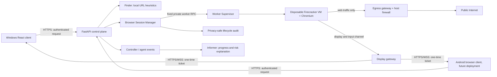
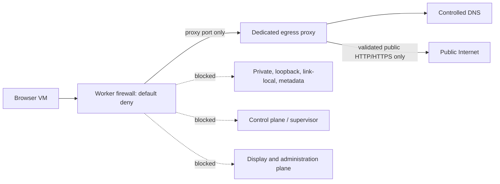
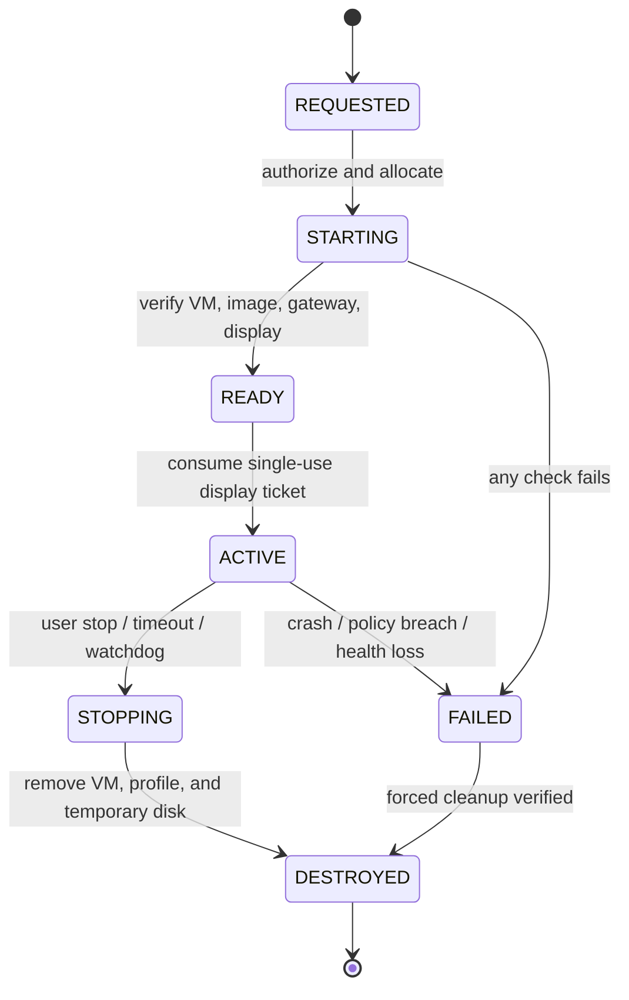
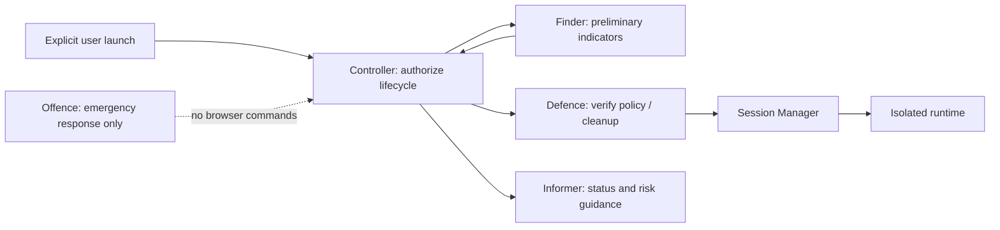

# Guard AI: Genuine Isolated Browser Preview

**Historical research.** Current decisions are in [GUARD_AI_MASTER_ARCHITECTURE.md](GUARD_AI_MASTER_ARCHITECTURE.md) and canonical [ISOLATED_BROWSER_ARCHITECTURE.md](ISOLATED_BROWSER_ARCHITECTURE.md); current findings are in [SECURITY_AUDIT_FINDINGS.md](SECURITY_AUDIT_FINDINGS.md). Preserve this research, but defer to canonical records where details have since been resolved.

> This research document is preserved. Current architecture decisions and ownership are canonical in [GUARD_AI_MASTER_ARCHITECTURE.md](GUARD_AI_MASTER_ARCHITECTURE.md); detailed browser design is in [ISOLATED_BROWSER_ARCHITECTURE.md](ISOLATED_BROWSER_ARCHITECTURE.md); implementation phases are in [BROWSER_RUNTIME_MVP_IMPLEMENTATION_PLAN.md](BROWSER_RUNTIME_MVP_IMPLEMENTATION_PLAN.md); and current security findings are in [SECURITY_AUDIT_FINDINGS.md](SECURITY_AUDIT_FINDINGS.md). Where this earlier research differs, defer to those records. FastAPI performs user/API authentication and authorization; Controller coordinates already-authorized lifecycle events. Canonical lifecycle, display-ticket exchange and network direction supersede this draft's diagrams.

## Purpose and approval status

This document describes a proposed architecture for inspecting suspicious websites in a disposable, isolated browser session. No browser runtime, worker, egress/display gateway, or remote display service is implemented. A metadata-only browser-session API and worker authorization-ticket foundation exist but do not start or render a browser. Implementation requires explicit approval after review; current Milestone 5 evidence is in [MILESTONE_5_ACCEPTANCE_FRAMEWORK.md](MILESTONE_5_ACCEPTANCE_FRAMEWORK.md).

The architecture preserves Guard AI's React/FastAPI application and agent roles. It does not substitute an iframe, HTML sanitizer, Playwright browser context, or backend URL fetch for a system isolation boundary.

## Executive recommendation

Use a **separate Linux/KVM worker running one Firecracker microVM per browser session** as the canonical runtime. Keep the React frontend and FastAPI as the control plane. Give the browser VM no host mounts, credentials, direct network route, or persistent profile. Permit web traffic only through a separately controlled egress gateway. Stream the remote display and limited user input through HTTPS/WSS.

Implement one runtime provider first. Keep a narrow supervisor interface that could support a future Windows Hyper-V provider, but do not operate both providers or automatically fall back between them in the first release. The same policy must be independently verified for every future provider.

This design is appropriate when Guard AI can use a dedicated Linux/KVM worker and the goal is to keep hostile page content away from Windows and Android clients. It changes the existing local-only deployment model: a remote worker and authenticated HTTPS/WSS access path are required for Android clients. A self-hosted on-premises worker avoids a third-party browser execution provider but still exposes the worker's public network identity to websites.

## Existing implementation assessment

| Area | Status | Current behavior and limits |
| --- | --- | --- |
| URL review API | **Partially implemented** | `POST /api/v1/sandbox/preview-url` validates URL syntax, requires `sandbox:write`, and returns local review. It does not fetch or render the page. |
| Finder/browser analysis | **Partially implemented** | Finder uses lexical phishing heuristics and a local browser posture check. Live response headers are not fetched; a low score does not establish safety. |
| File preview | **Implemented, limited** | Uploads are bounded by configured size; the response shows a raw byte preview of up to 512 bytes. It does not execute files. |
| Genuine isolated browser | **Not implemented** | A metadata-only session manager/API and authorization lifecycle exist. There is no browser process, VM supervisor, egress gateway, session-specific runtime storage, or remote display service. |
| HTML sanitizer helper | **Unverified and unused** | `BrowserSecurityAgent.sanitize_html_for_sandbox` uses regular expressions and is not called by URL review. It must not be relied on as isolation or safe HTML sanitization. |
| Controller/agents | **Partially implemented** | Agents run in one FastAPI process on a synchronous in-memory event bus. Controller records threat events; Defence locks the vault on elevated findings; Informer produces explanations; Offence handles local incident simulations. Persisted metadata authorization exists, but there is no distributed runtime orchestration, guest monitoring, or browser lifecycle execution. |
| Authentication | **Implemented, configuration required** | Protected API routes use role-checked bearer authentication. Auth fails closed until a signing secret and active account are configured. |
| Browser lifecycle/audit | **Partially implemented** | Metadata session state and authorization audit exist. Runtime health verification, VM/browser lifecycle, cleanup, and cleanup verification do not exist. |

Relevant existing files are `backend/app/routers/sandbox_api.py`, `backend/app/services/sandbox_engine.py`, `backend/app/agents/finder.py`, `backend/app/agents/defence.py`, `backend/app/agents/controller.py`, `backend/app/agents/informer.py`, `backend/app/agents/offence.py`, and `frontend/src/components/IsolatedSandbox.jsx`.

The 39 backend and 19 frontend test-definition counts in this historical assessment are not current. Latest backend execution evidence is maintained in [MILESTONE_5_ACCEPTANCE_FRAMEWORK.md](MILESTONE_5_ACCEPTANCE_FRAMEWORK.md). Existing sandbox coverage asserts that remote pages are not fetched or rendered; no runtime isolation tests have been run.

## Deployment options

| Factor | Local Windows Hyper-V worker | Separate Linux/KVM Firecracker worker | Hybrid |
| --- | --- | --- | --- |
| Isolation | VM with a separate guest kernel. Virtual switches, host integration, and the privileged supervisor remain critical controls. | KVM-backed microVM with a minimal device model and Firecracker jailer; host kernel, KVM, and VMM remain in the trusted computing base. | Provides either VM boundary, but each implementation needs independent security validation. |
| Platform requirements | Microsoft lists Windows 10/11 Pro or Enterprise, SLAT-capable 64-bit CPU, hardware virtualization, and 4 GB minimum memory for Hyper-V. Windows Home does not support Hyper-V. Windows 10 reached end of support in October 2025; it should not be the normal supported baseline in 2026 unless a relevant support program applies. | Linux x86_64 or aarch64 and KVM access to `/dev/kvm`. Use a physical Linux worker or a provider explicitly supporting KVM; do not assume nested virtualization or WSL2 is a supported Firecracker host. | Capability detection and separate OS, image, network, and support policies are required. |
| Windows/Android client fit | Good for a local Windows desktop on a supported edition. Android cannot reach the existing loopback-only FastAPI service without a deliberate remote-access design. | Both clients can use the same remote browser display in a modern browser after deployment behind authenticated HTTPS/WSS. | Client-compatible, but requires two tested runtime backends and policy parity. |
| Startup/concurrency | Hyper-V guest readiness and capacity must be benchmarked. Windows Sandbox is not a session service: its defaults enable networking and clipboard, and Microsoft documents a single simultaneous instance. | Firecracker's published ≤125 ms figure is to minimal Linux guest init, not browser-ready time. Browser, display, and page startup dominate and must be measured. Concurrency is limited by guest memory, CPU, stream encoding, and network. | Capacity, lifecycle semantics, and startup differ between providers. |
| Network enforcement | Host virtual-switch/firewall rules can enforce policy, but privileged management and host-specific configurations increase engineering. | Dedicated guest interfaces, host firewall, and egress gateway form an explicit network boundary. The gateway must not route to control or private networks. | Equivalent deny behavior must be tested separately on both platforms. No fallback on worker failure. |
| Operations/cost | Moderate for a single local-user prototype; constrained by Windows edition, host resources, administrative setup, and local API reachability. | Higher initial infrastructure and operations cost; clearer remote-client and centralized-worker model. | Highest development and maintenance cost. More images, patch cycles, policy code, failure modes, and test matrix. |

Microsoft's Hyper-V system requirements are documented [here](https://learn.microsoft.com/en-us/windows-server/virtualization/hyper-v/get-started/install-hyper-v); its Windows lifecycle information is [here](https://learn.microsoft.com/en-us/lifecycle/faq/windows). Firecracker requires Linux/KVM as described in its [getting-started guide](https://github.com/firecracker-microvm/firecracker/blob/main/docs/getting-started.md). Firecracker's microVM performance figures are for minimal configurations; see its [specification](https://github.com/firecracker-microvm/firecracker/blob/main/SPECIFICATION.md). Production setup requires explicit resource limits and host/guest maintenance; see [Firecracker production guidance](https://github.com/firecracker-microvm/firecracker/blob/main/docs/prod-host-setup.md).

## Selected technology stack

**Proposed, not implemented:**

- Firecracker microVM per session on a dedicated Linux/KVM worker, using a pinned and signed Linux guest image with Chromium.
- Firecracker jailer, unique per-VM UID/GID and directories, cgroups, restricted API socket, immutable base image, and disposable writable overlay.
- Default-deny worker firewall plus a dedicated controlled HTTP/HTTPS egress gateway. The gateway is separate from the management and display paths.
- Apache Guacamole web client and gateway with a VNC endpoint in the guest for remote display and limited input. Guacamole is a display/input transport, not the isolation boundary. Its official architecture is documented [here](https://guacamole.apache.org/doc/gug/guacamole-architecture.html), and its browser/mobile client model [here](https://guacamole.apache.org/doc/gug/introduction.html).
- Existing React/FastAPI control plane, extended later with typed session lifecycle operations and a narrowly scoped worker broker.
- Existing user authentication for API authorization, exchanged for a short-lived, session-bound display ticket. Never send the Guard AI bearer token into the guest or place stream credentials in URLs.
- Existing SQLite/audit facilities only for privacy-safe lifecycle metadata. Do not store page contents, screenshots, cookies, credentials, stream tokens, or sensitive full URLs.

Ordinary containers share the host kernel and can be weakened by unsafe mounts/capabilities, as Docker's security guidance explains [here](https://docs.docker.com/engine/security/). Playwright browser contexts isolate cookies and storage but are not a VM/host boundary; see [Playwright isolation](https://playwright.dev/docs/browser-contexts). Chromium Site Isolation is useful defense in depth between websites, not a replacement for separating the browser workload from the endpoint; see the [Chromium design](https://www.chromium.org/developers/design-documents/site-isolation/).

## Component responsibilities and interfaces

| Component | Responsibilities; inputs/outputs; communication | Trust boundary, permission, and failure behavior |
| --- | --- | --- |
| **Browser Session Manager** | Accepts an authenticated user, validated URL, and policy profile; creates/queries/stops sessions; returns opaque session ID, state, and one-time display ticket. Calls only fixed worker operations. | Control-plane component. No user-supplied shell, VM configuration, mounts, or image names. Worker errors deny creation; never fall back to direct fetching. |
| **Isolated Browser Runtime** | Boots fixed guest image; creates fresh browser profile; opens the submitted URL; emits display output and minimal health state. | Treat browser and guest as compromised. No host files, profile, secrets, upload/download, clipboard, password manager, camera, microphone, USB, or application token. Missing controls means no browsing. |
| **VM/MicroVM Supervisor** | Creates/destroys Firecracker instances from pinned artifacts; applies CPU, memory, process, disk, and lifecycle limits. | High-trust Linux worker component with KVM access. Firecracker API is local-only. Use jailer, unique UID/GID, cgroups, namespaces, and per-session directories. Supervisor failure blocks new sessions and triggers cleanup. |
| **Network Egress Gateway** | Provides controlled DNS and outbound web proxy; validates destinations at connection time; enforces bandwidth and connection limits. | Separate network boundary. Browser guests can reach only this gateway; the gateway has no route to management/private networks. Gateway failure means no browsing. |
| **Remote Display and Input Service** | Proxies guest display and limited user input to the React client over HTTPS/WSS; disables clipboard and file transfer. | Separate from Internet egress. Restrict each display connection to its authorized session and endpoint. Reject expired, replayed, or wrong-origin tickets. |
| **Session Authentication Service** | Exchanges an API-authorized request for a short-lived, session-bound, single-use stream capability. | Never forwards API credentials to guest/display. Verify user/session binding, origin, expiry, and replay. Deny on uncertainty. |
| **Health Monitor and Watchdog** | Verifies worker, image digest, supervisor, egress policy, display path, and stale sessions. | Read-only monitoring where possible; cleanup rights restricted to Guard AI-owned instances. Missing checks prevent launch. |
| **Audit and Lifecycle Service** | Records actor, opaque session ID, lifecycle transitions, policy/image version, times, and failure category. | No page content, full sensitive URL/query, cookies, stream token, or credentials. Storage or audit failure must not permit an unverified session. |

### Communication and privilege rules

- React calls FastAPI over authenticated HTTPS. FastAPI speaks to the worker broker over an authenticated private control channel.
- The worker broker accepts typed create/status/destroy messages only. It has no general command-execution API.
- The supervisor invokes Firecracker through a local socket. That API is not reachable from browser guests or the public network.
- Browser VMs have an egress interface that reaches only the gateway and a separate restricted display/control path. They have no route to the API, supervisor, database, or worker administration plane.
- The display capability is exchanged outside the URL, expires quickly, is single-use, and is bound to the user, session, and expected origin.

## Data flow

1. User submits a URL for local heuristic review. Finder reports indicators; it never asserts that a low score proves safety.
2. Starting an isolated session is a separate, explicit user action. An AI score/event never starts a browser session automatically.
3. FastAPI authorizes the user and asks the session manager to start the fixed, signed browser image.
4. The supervisor creates a fresh microVM/profile. The guest is isolated before any URL is opened.
5. Browser traffic is routed through the gateway. The React UI receives a remote display stream, not website HTML in Guard AI's DOM.
6. User stop, timeout, crash, health loss, or policy failure terminates the guest and removes temporary state.
7. The audit service records only necessary lifecycle metadata.

The current API binds to `127.0.0.1` and is not ready for direct remote/mobile access. Android support requires a deliberate HTTPS/WSS deployment behind an authenticated reverse proxy or Zero Trust access gateway, with FastAPI and worker control ports private. Do not expose the current API or worker ports directly to a LAN or the internet.

## Network security policy

The policy must:

- Deny loopback, private, link-local, reserved, multicast, IPv4-mapped IPv6, and cloud metadata addresses.
- Resolve DNS through the controlled resolver, validate the result at connection time, and pin the approved address while retaining the original hostname for HTTP `Host`, TLS SNI, and certificate verification.
- Reapply validation to every redirect and retry. OWASP calls out DNS pinning/rebinding and connection-time validation in its [SSRF Prevention Cheat Sheet](https://cheatsheetseries.owasp.org/cheatsheets/Server_Side_Request_Forgery_Prevention_Cheat_Sheet.html).
- Block direct TCP/UDP, direct DNS, DoH bypass, QUIC, WebRTC/STUN, and all non-approved ports. Use host firewall rules as well as proxy validation; a proxy-only policy without route enforcement is insufficient.
- Set per-session time, bandwidth, connection, concurrency, and response-size limits.

This design blocks the guest from reaching private targets through its assigned routes. It cannot stop a malicious public website from receiving information a user intentionally enters. The initial product should warn users not to enter credentials or secrets.

## Session isolation and lifecycle

Every session gets one microVM, a fresh ephemeral browser profile, unique temporary disk/overlay, and no shared browser state. Disable clipboard, password manager, file upload/download, host folder mounts, camera, microphone, printer, USB, and persistent storage. Any future download feature must use a separate quarantined export workflow and explicit confirmation.

Use terminal states and cleanup verification. After service restart, reconcile stale sessions and terminate only resources with Guard AI ownership labels. If gateway, supervisor, display, authentication, or cleanup state is uncertain, fail closed.

## AI agent integration

- **Finder AI (proposed integration):** provides local indicators and recommendations. It never declares a destination safe and never launches sessions.
- **Defence AI (proposed integration):** denies launch when isolation checks fail and coordinates cleanup. It does not retain browser cookies or profiles.
- **Controller AI (proposed integration):** applies existing role authorization, records lifecycle transitions, and requires explicit user action. Do not make a synchronous event-bus handler the only session watchdog.
- **Informer AI (proposed integration):** announces starting, active, blocked, stopped, and failed states; explains heuristics and advises against credential entry. Do not pass page instructions/content to agents.
- **Offence AI (existing role, unchanged):** remains defensive emergency response only. It does not browse, attack, or receive worker shell access.

No agent can bypass the egress gateway or execute arbitrary worker commands.

## Resource and feasibility estimate

The previous estimate of **2–4 GiB RAM and 1–2 vCPUs per active session is provisional**. Firecracker's published small VMM overhead and sub-125 ms boot measurements use minimal test guests, not a graphical browser session.

Initial MVP planning target (to benchmark, not a confirmed requirement):

- Dedicated Linux/KVM worker: 8 physical CPU cores, 32 GiB RAM, and at least 250 GB NVMe/SSD.
- Start with a cap of two concurrent sessions. Budget 2 vCPUs, 2–4 GiB guest RAM, and 4–8 GB disposable storage per session until measurements justify other values.
- Reserve 4–8 GiB RAM and 2–4 CPU cores for the host, supervisor, gateway, display services, and monitoring. This is a planning allowance only.
- Use software rendering and a 720p display profile initially; GPU passthrough and higher resolution require separate capacity and threat review.
- Keep guest base images immutable and use a fresh disposable overlay per session.

Benchmark boot-to-browser-ready latency, browser memory peak, CPU, display encoding cost, stream bandwidth, cleanup time, and concurrency using representative and hostile pages. Increase limits only after repeatable resource and security verification. A 16 GiB machine is a one- or two-session development target at most, not a scale claim. Real capacity depends on browser behavior and streaming workload.

## Security verification strategy

Before enabling the feature, verify:

- The VM image signature/digest and browser version match policy.
- No host directory, clipboard, device, browser profile, or application token is exposed to the guest.
- The guest has no route except to the egress gateway and authorized display channel.
- Loopback/private/link-local/reserved/metadata and IPv6 edge cases are blocked.
- DNS rebinding, redirects to blocked addresses, direct DNS/DoH, UDP/QUIC, WebRTC, and proxy failure all fail closed.
- Session A cannot access Session B's cookies, local/session storage, cache, IndexedDB, service workers, files, process state, or display channel.
- Tickets are bound to user/session, expire, reject replay, and never appear in URLs or logs.
- CPU, memory, disk, time, bandwidth, and connections are bounded.
- Browser, VM, worker, gateway, display, and API failures terminate safely and are reported without leaking page data.
- Cleanup verifies temporary VM/profile/disk deletion; restart reconciliation cannot terminate unrelated VMs.
- Audit records exclude page content, screenshots, cookies, tokens, credentials, and sensitive URL components.
- Packet-level tests using private/metadata canary endpoints prove no guest-originated traffic reaches them.

Functional browsing tests alone do not prove containment. Test gateway and worker outages, firewall misconfiguration, image-signature mismatch, session-token replay, resource exhaustion, and crash cleanup deliberately.

## Development phases

1. Approve the runtime target, deployment ownership (on-premises or hosted), Android scope, and data-residency expectations.
2. Build a fixed-image Firecracker worker with jailer, per-session overlay, typed supervisor API, and verified destruction.
3. Implement and test host firewall and egress policy before enabling browser navigation.
4. Integrate the display gateway and one-time session tickets without clipboard or file transfer.
5. Add authenticated FastAPI create/status/stop operations and privacy-safe audit records.
6. Add explicit React launch/status/stop controls and mobile-browser stream support only after secure HTTPS/WSS deployment.
7. Run adversarial integration, cleanup, failure, and capacity tests; document only properties that were demonstrated.

A future Hyper-V provider is a separate project phase. It requires its own networking implementation and complete security verification. There is no transparent fallback between providers.

## Known limitations and unresolved risks

- VMs reduce endpoint exposure but cannot guarantee protection against browser, guest-kernel, KVM, host-kernel, hypervisor, or remote-display vulnerabilities.
- A compromised worker or egress gateway can affect sessions; administration, patching, and network separation are part of the security boundary.
- Websites see the worker's public egress IP. A third-party hosted worker adds privacy, data-processing, and residency considerations.
- The display protocol and client-side stream renderer are additional attack surfaces.
- Public websites may still receive data a user deliberately enters. Credential use and downloads are out of scope for the first release.
- Android has no current native Guard AI client; the existing companion is a demo. A mobile browser can display the session only after the control plane and stream are deployed behind authenticated HTTPS/WSS.
- Windows Hyper-V is unavailable on Windows Home. Windows 10 support has ended except for applicable support arrangements. A local Hyper-V option would need explicit host edition, virtualization, admin, and capacity checks.

## Approval gate

This is a proposed architecture, not an implemented or production-ready feature. **Do not begin runtime implementation until the user explicitly approves the selected Linux/KVM Firecracker worker and its deployment model (self-hosted/on-premises or hosted).**
