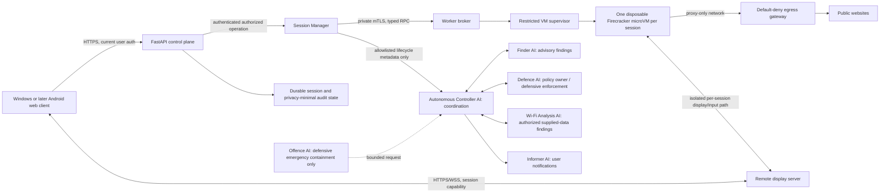
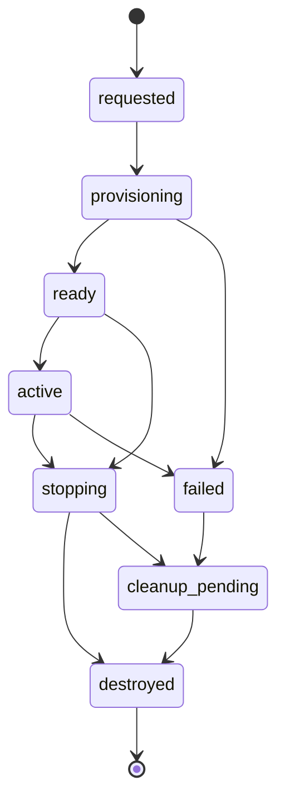

# Guard AI Browser Runtime MVP Implementation Plan

## Status and evidence boundaries

This is an implementation plan only. **No hosting option has been approved, no suitable Linux/KVM worker is known to exist, and no browser runtime, worker API, network gateway, or remote display service is implemented.** The research and proposed architecture are documented in [ISOLATED_BROWSER_ARCHITECTURE.md](ISOLATED_BROWSER_ARCHITECTURE.md), the earlier research in [BROWSER_ISOLATION_ARCHITECTURE.md](BROWSER_ISOLATION_ARCHITECTURE.md), and the practical host assessment in [INFRASTRUCTURE_FEASIBILITY.md](INFRASTRUCTURE_FEASIBILITY.md).

Labels used here:

- **Verified:** observed in repository or the prior read-only host assessment.
- **Assumption:** a planning value that has not been measured or approved.
- **Proposed:** a design choice for review; not an implementation commitment.
- **Pending:** requires the user's decision before infrastructure spending or runtime work.

Existing URL review remains local heuristic review and does not fetch or render websites. This plan changes no source implementation; target agent responsibilities and ownership decisions are in [GUARD_AI_MASTER_ARCHITECTURE.md](GUARD_AI_MASTER_ARCHITECTURE.md). The React/FastAPI control plane remains the existing application boundary. It is loopback-oriented and is not ready for remote exposure.

## Hosting decision framework

### Verified facts

- The application currently runs as a Windows React/Vite client and FastAPI process bound to `127.0.0.1`; it uses configured bearer authentication and role checks.
- The development laptop was reported as Windows 11 Home with 15.7 GiB RAM, WSL absent, and conflicting virtualization indicators. It is not a supported local Hyper-V worker and Linux/KVM access was not established.
- Firecracker needs a supported Linux host with usable KVM. No Linux/KVM worker has been identified.
- Existing SQLite and in-process event bus support the local prototype, not a distributed session service or multi-worker lifecycle.
- No cloud region, provider, price quote, budget authorization, privacy policy, data residency, availability target, or expected concurrency has been provided.
- Android support in the repository is demonstration-only; there is no native Android client or real pairing flow.

### Hosting comparison

| Option | Technical requirements and Firecracker compatibility | Advantages | Disadvantages, privacy, and security | Operations, scale, and cost assumptions |
| --- | --- | --- | --- | --- |
| **Existing on-premises Linux/KVM hardware** | A separately available, supported Linux server; hardware virtualization enabled and `/dev/kvm` usable by a restricted supervisor; sufficient RAM/CPU/SSD; isolated guest networking; firewall/proxy and reliable outbound connectivity. Firecracker is compatible only if host/KVM and architecture requirements are met and validated. | Direct ownership of hardware and data path; can avoid recurring dedicated-cloud compute charges; can keep worker traffic within an organization-controlled network. | Availability of such hardware is **unknown**. Requires physical access control, network segmentation, secure remote administration, patching, image signing, backup/recovery, monitoring, power/connectivity resilience, and incident response. Worker public IP is visible to sites. Local IT operators can access host metadata. | Hardware purchase/depreciation, electricity, cooling, internet, replacement parts, and staff time are often omitted from apparent zero marginal cost. Single server is a failure and capacity bottleneck. Add worker capacity manually; no HA unless more hosts and orchestration are funded. |
| **Cloud Linux/KVM bare-metal or explicitly KVM-capable host** | Provider/instance must explicitly expose KVM to a supported Linux host; verify `/dev/kvm` before selection. Bare metal is the conservative assumption; do not assume ordinary virtual machines support nested KVM. Place worker, broker, gateway, and display components in a least-privilege network design. | Remote access, repeatable host provisioning, provider hardware replacement, easier expansion, and no dependency on a local office server. Can release some capacity when idle only if the selected service and architecture support safe stop/start. | Provider has control-plane/physical access and sees network metadata; jurisdiction, contractual terms, residency, public egress IP and provider incident response matter. Publicly reachable services increase attack surface. Dedicated KVM capacity can be costly; egress/NAT/display costs accumulate. | Compute, persistent disks, IPs/load balancer, egress gateway, data processing/transfer, logs, backups, taxes and support are separate cost lines. No quote or budget exists. Autoscaling/HA adds orchestration and policy complexity; a first worker remains a single point of failure. |
| **Hybrid Windows control plane + separate Linux/KVM worker** | Preserve React/FastAPI on Windows; Linux worker communicates over private VPN/VPC or outbound authenticated tunnel. Windows API requires a deliberate remote HTTPS/WSS edge if accessed outside localhost; only a narrow authenticated worker broker is reachable from FastAPI. Firecracker runs on Linux/KVM, not the Windows client. | Fits existing app and agent boundaries, isolates hostile pages from Windows, enables remote display and eventual browser-based Android access, and permits either on-prem or cloud worker hosting. | Adds a distributed trust boundary, network failure modes, session-state synchronization, identity management, and remote display attack surface. Hosting location still has to be chosen. Current loopback API must not simply be exposed. | Two operating environments and two patch/monitoring domains. Capacity is initially bounded by the selected worker. Costs depend on whether the Linux worker is on-prem or cloud; a separate gateway/display path may add recurring fees. A single worker/control plane is not highly available. |

### Cost estimates and assumptions

No provider quote or approved budget exists. The figures below are planning examples only and must be recalculated for chosen hardware, provider, region, uptime, traffic and taxes.

| Scenario | Planning estimate | Assumptions and exclusions |
| --- | --- | --- |
| Existing on-prem server | **$0/month cloud compute only if suitable hardware is already owned**; incremental electricity is `average added watts ÷ 1000 × 730 × local price per kWh`. For illustration, an assumed 100–250 W average worker draw is 73–183 kWh/month. | Not a claim that hardware exists or that power use will be in this range. Excludes acquisition/depreciation, cooling, network, backup, labor, replacement and support. Local electricity rate is unknown. |
| Cloud KVM/bare-metal worker | Budget for **hundreds of USD/month as a rough planning order for continuously available dedicated compute**, before gateway, storage, data transfer, logs and support. | Not a quote; exact instance type, region, pricing and whether a provider exposes KVM are unknown. Obtain regional pricing for an actual eligible host before approval. |
| Hybrid Windows control plane + remote worker | **Worker-host cost plus the private connection, remote display/HTTPS edge and traffic costs**; the existing Windows app adds no separate cloud worker charge if it remains on the user's development machine. | If a managed cloud NAT gateway is selected, the prior assessment's AWS Ohio example is about $32.85/month at $0.045/hour for 730 hours, before processing and transfer. Rates vary by region and service; see [the feasibility cost model](INFRASTRUCTURE_FEASIBILITY.md#cost-model-and-illustrative-floor). |

For every option, budget the lifecycle overhead: patching, observability, backups or image rebuilds, security review, incident response and unused capacity. A time-bounded worker can reduce compute hours only where the provider's pricing and safe teardown permit it; gateways, IPs, storage, traffic and logs may still accrue. Do not provision until a maximum monthly budget and spend-alert threshold are approved.

### Provisional default

**Provisional recommendation, pending user approval:** use the hybrid shape, keeping the current Windows React/FastAPI application as the control plane and placing Firecracker on a separate private Linux/KVM worker. First ask whether suitable on-prem hardware already exists. If it does not, compare a time-bounded, spending-capped cloud bare-metal pilot against the user's budget and privacy requirements. The recommendation does **not** imply that either host exists, that a provider has been selected, or that spending is approved. Do not attempt to convert the assessed Windows laptop into a worker.

### Decisions requiring user input

| Decision | Current state | Needed before |
| --- | --- | --- |
| Is a separately administered Linux server available? Who owns and patches it? | **Unknown** | Phase A and any local/on-prem work |
| If not, is cloud bare-metal acceptable? Which provider/account may be used? | **Unknown** | Any cloud provisioning |
| Maximum monthly spend, pilot duration, and alert/stop threshold? | **Unknown; no budget approval** | Costed design or provisioning |
| Preferred region/jurisdiction and data-residency constraints? | **Unknown** | Selecting host, display gateway, logs, or backups |
| What URL/session metadata may be retained, for how long, and who can access it? | **Unknown** | Persistent audit/session schema |
| Expected sessions per day and maximum concurrent sessions? | **Unknown** | Host sizing, quotas, pricing, and load acceptance |
| Is the first MVP local-only, remotely hosted, or a local control plane with a remote worker? | **Pending** | Network/auth and client design |
| Which users may start sessions, and is explicit confirmation required each time? | **Pending** | API permission and UI behavior |
| Are sign-in to sites, downloads, uploads, clipboard, or file export ever allowed? | **Pending; MVP recommendation is no** | Product and threat model changes |
| Is Android mobile-web access in MVP scope, or desktop only? | **Pending; recommend defer until HTTPS/WSS path is ready** | Phase E/G acceptance criteria |
| Required availability/recovery time and who responds to failed cleanup? | **Unknown** | Phase A operational ownership |
| Is the proposed Guacamole/VNC display stack acceptable after license and maintenance review? | **Proposed, unapproved** | Phase E technology selection |

## MVP architecture and boundaries

### Proposed topology

All runtime components in this diagram are proposed. FastAPI remains the user-facing authorization boundary; the React client never calls the supervisor or worker broker directly. The guest receives no Guard AI API token, host mount, user browser profile, local network route, or persistent identity. Finder's optional heuristic review is a separate user-requested workflow and is never a prerequisite or launch authority for a browser session; keep raw session URLs out of its threat-report path.

### Control-plane API responsibilities

**Proposed user-facing API** (names are illustrative; settle route naming during implementation):

| Operation | Example contract | Authorization and behavior |
| --- | --- | --- |
| Create | `POST /api/v1/browser-sessions` with `{url, policy_profile}`; returns `{session_id, status}` | Require authenticated role permission. Existing `sandbox:write` is available to the configured operator role (and admin wildcard); reuse or refine it only after permission review. Add per-session owner checks, which the current URL preview endpoint does not need. Validate URL syntax and profile against fixed allowlisted profiles. Require explicit user action/confirmation; never launch from Finder score or agent event. Idempotency key prevents duplicate launch on retries. |
| Read status | `GET /api/v1/browser-sessions/{id}` | Enforce owner/role check every time. Return state, timestamps, and safe failure category; do not include page data or secret capabilities. |
| Stop | `DELETE /api/v1/browser-sessions/{id}` | Owner/authorized operator only; revoke display access immediately; request idempotent destroy and report `stopping` until cleanup is verified. |
| Connect display | Protected handshake or one-time ticket exchange for session | Verify user, origin, session binding, expiry, and single-use/replay state. Do not place reusable credentials in URLs or logs. |
| Health/readiness | Internal worker health endpoint and existing public app health kept distinct | Worker readiness is private and authenticated; readiness must verify required security controls, not merely process liveness. |

FastAPI remains responsible for existing user identity, permissions, validation, quotas, policy selection, session ownership, lifecycle API, and user-facing errors. **The existing Controller AI does not implement API authorization:** current authorization is enforced by FastAPI dependencies in `app/security/auth.py`. Controller may coordinate lifecycle events only after FastAPI authorizes them; it must not become a substitute authorization boundary. FastAPI must not execute arbitrary guest/worker shell commands. Preserve the present localhost development deployment unless a separate remote HTTPS design is approved.

The future session URL validator should accept only the approved HTTP/HTTPS policy, reject embedded userinfo and malformed authorities/ports/control characters, and define one consistent hostname/IDNA and IP-literal normalization. Treat every redirect and subresource as a new untrusted network request subject to gateway policy. API validation is not an SSRF control and does not replace connection-time egress enforcement.

The current principal is a configured username, role and token ID. Before persistent cross-process ownership is introduced, decide on a stable internal subject identifier and its lifecycle. Every create/read/stop/connect operation must check caller permission and session owner; an opaque session ID is not authorization. Existing bearer tokens are held in frontend JavaScript memory and remain exposed to same-origin script compromise, as described in [ARCHITECTURE.md](ARCHITECTURE.md). A remote deployment therefore needs a separately reviewed TLS, origin, identity, rate-limit and account-protection design; current prototype auth is not production-ready.

### Worker broker and supervisor contract

The broker accepts only versioned, schema-validated operations such as:

- `CreateSession(session_id, image_digest, policy_id, resource_limits, expiry)`
- `GetSession(session_id)`
- `DestroySession(session_id, reason)`
- `GetWorkerHealth()`
- `ListOwnedSessions()` for restart reconciliation only

Use mutually authenticated workload identity, request timestamp/nonce or replay-resistant transport, bounded payloads, timeouts, idempotency, and structured error codes. Restrict the broker to a dedicated service identity. It invokes a local-only supervisor socket. No guest or public route can access broker, Firecracker API socket, host SSH, management network, or another VM. Do not accept client-provided shell, image path/digest, mount, CPU/memory values, networking, or command line.

**Authentication is not authorization:** mTLS establishes peer identity but does not decide whether that identity may create, inspect, or destroy a particular session. Define a service authorization matrix and enforce allowed operations, fixed image/policy IDs, resource ceilings, per-user and global concurrency, ownership tags, and session-ID scope at the broker. Bind the authenticated FastAPI service identity to requested owner claims using an integrity-protected request contract; do not trust arbitrary owner fields. Define identity issuance, rotation, revocation, expiry, clock-skew tolerance and emergency disable. Never use user JWTs as worker credentials.

The supervisor verifies pinned and signed image artifacts, allocates one Firecracker microVM and fresh writable overlay per session, applies CPU/memory/disk/process limits, establishes network rules before boot/navigation, attaches only approved display and egress paths, and destroys VM/process/overlay/network resources. The MVP must fail creation if image signature, policy version, KVM, firewall, gateway or display readiness cannot be verified.

Firecracker itself does not filter guest network traffic; the host network path must enforce the guest egress policy. Its production guidance calls for the jailer or equivalent restrictions, per-VM identities/limits, host maintenance and host firewall rules ([Firecracker production host setup](https://github.com/firecracker-microvm/firecracker/blob/main/docs/prod-host-setup.md), [network setup](https://github.com/firecracker-microvm/firecracker/blob/main/docs/network-setup.md)). These are operator-owned prerequisites, not protections provided automatically by the VMM.

### Egress gateway

The gateway owns DNS and outbound destination policy. Guests have no direct internet route. Allow only required HTTP/HTTPS proxy traffic; block direct DNS, UDP/QUIC, WebRTC/STUN, unapproved ports, loopback, private, link-local, reserved, multicast, metadata, IPv4-mapped IPv6 and internal management ranges. Validate DNS resolution at connection time, pin approved addresses for each connection, and repeat validation on redirects and retries. Enforce with both worker firewall/routing and gateway policy. On gateway loss, deny traffic and terminate or suspend affected session; never fall back to direct networking. Rate-limit bytes, connections, request size, and duration.

No MVP downloads, uploads, clipboard, host sharing, credentials, or persistent browser profile. Product requirements that add those features require a separate threat review.

The data path must name actual interfaces, routes and permitted ports for egress and display. The current proposal says the guest emits a display stream, but the Guacamole/VNC topology and connection direction are not selected. Before Phase E, choose whether the gateway connects to a per-VM VNC endpoint over a dedicated display network or another reviewed transport. Do not expose display endpoints on the guest's Internet egress interface; permit only the gateway identity/address to the session-specific endpoint. No route may bridge display to guest Internet, worker management, FastAPI or other sessions.

### Remote display and input

Use a separately authenticated HTTPS/WSS display path (Guacamole/VNC is the current proposal, not a selected or deployed service). Bind a short-lived, single-use capability to user, session, origin and expiry, validate origin at WebSocket upgrade, revoke on stop/logout/expiry, and avoid query-string secrets. Limit display/input to keyboard and pointer; disable clipboard, file/channel redirection, drive mapping, camera, microphone, printer and USB. Treat display server and frontend stream decoder as part of the attack surface. The guest has no direct connection to the user's device; the display service terminates the remote protocol.

### Session lifecycle and audit

Persist a lifecycle state machine, using the repository's existing persistence only after evaluating migration and transaction/concurrency limitations:

States: `requested`, `provisioning`, `ready`, `active`, `stopping`, `destroyed`, `failed`, and `cleanup_pending`. Each transition is owner-checked, time-bounded, auditable, and idempotent. `destroyed` is terminal only after VM termination, session profile/overlay access removal, network detachment, display mapping revocation, temporary credential invalidation, and per-session data-key destruction are independently confirmed. This does not prove physical storage sanitization. Cleanup failures remain visible and trigger retry/alerting. On restart, reconcile only Guard AI-labeled resources; never broadly stop unrelated virtual machines.

Audit allowlist: actor ID (or existing safe actor reference), opaque session ID, transition, timestamp, policy/image version, and categorized result/reason. Do not retain page contents, screenshots, DOM, cookies, credentials, full sensitive URLs/query strings, or display tickets. Decide whether hostname or redacted URL metadata is needed and its retention before schema work. Audit storage failure should deny new sessions; cleanup should still proceed and report an operational error.

**Existing source-data caveat:** Finder URL scans currently emit the submitted URL as the threat indicator and include the URL in report details stored by Controller (`ThreatEvent.indicator` and `details_json`). Session URLs may contain sensitive query parameters or identifiers. Do not route raw session URLs or guest/browser content through Finder/Controller event payloads or existing general threat-report persistence without an approved redaction and retention design. Give agents only an opaque session ID, allowlisted lifecycle state, and separately approved redacted indicators. The existing database audit chain is tamper-evident within retained records; it is not immutable and is not a substitute for confidential or durable distributed session storage.

Deleting an overlay does not prove physical erasure, especially on SSDs, snapshots, backups, swap or crash dumps. Use per-session encrypted writable storage with unique ephemeral data-encryption keys, prevent persistence in snapshots/backups and swap where feasible, and verify VM/network/key teardown. Destroying the per-session key is the primary cryptographic-erasure control; document residual storage remanence. Do not claim secure deletion based only on unlink or file absence.

### Timeouts and failure behavior

**Unapproved planning assumptions, not acceptance thresholds:** maximum session lifetime 15 minutes; idle timeout 5 minutes; create/read/stop RPC deadlines 5/3/10 seconds; provision deadline 60 seconds. These starting caps require owner approval and measurement. Phase C must persist the policy version and enforce server-side hard bounds; disconnect must never reset lifetime. Readiness must be distinct from liveness: a live process is not ready unless KVM access, pinned image digest, supervisor/jailer policy, capacity, required firewall rules, gateway reachability/health, display path and cleanup backlog meet approved checks. Exact capacity thresholds and stale-health deadline remain pending host sizing and operations objectives.

- Worker unreachable or identity invalid: no new session; existing session state becomes unknown, display tickets are not minted, and watchdog/reconciliation takes over.
- Image/policy/signature mismatch or firewall/gateway not ready: reject before guest navigation.
- Browser/VM crash: revoke stream ticket, stop session, attempt verified cleanup, emit minimal failure event.
- Gateway or display health loss: fail closed; no network bypass; stop or suspend session per policy and expire its capability.
- Client disconnect: keep server-side expiry active; reconnect only after ownership and ticket reauthorization. Disconnect never extends lifetime.
- Cleanup timeout/failure: mark `cleanup_pending`, alert, retry with bounded backoff, block new launches if worker safety/capacity cannot be assured.
- DB/session-state failure: refuse creation and new ticket issue. Allow restricted cleanup using worker ownership tags and reconciliation state.
- Resource exhaustion: apply per-session cgroups and global admission control; reject excess requests rather than overcommit silently.

## Agent integration review

Preserve existing role boundaries:

| Agent | Proposed interaction with session lifecycle | Prohibited behavior |
| --- | --- | --- |
| **Controller AI** | Orchestrates and records authorized lifecycle events through the session manager; respects explicit human confirmation and existing role checks; emits status events for the UI. Long-running health/cleanup must be handled by a durable worker watchdog, not only the existing synchronous in-process event bus. | Must not infer user approval, launch automatically from a threat event, or bypass API authorization. |
| **Finder AI** | Provides local heuristic URL indicators and explains uncertainty before optional user launch. It may supply findings as context to the user and audit metadata. | Must not declare a site safe based on score, fetch/render the page in the control plane, or create a browser session automatically. |
| **Defence AI** | Owns isolated-browsing, URL-protection, sandbox/private-session policy, isolation readiness and defensive session enforcement while preserving existing vault protections. Session Manager, Worker Supervisor, Egress Gateway, Display Gateway and Cleanup Manager execute bounded operations under Defence policy. | Must not access guest content/cookies or hold broad worker shell access; cannot delegate authority to weaken policy. |
| **Offence AI** | Remains limited to existing local incident simulation/defensive response semantics. | Must not perform attacks against websites, scan external targets, issue browser exploit actions, or receive arbitrary worker commands. |
| **Informer AI** | Reports starting/active/blocked/stopped/failed state and explains policy warnings in plain language; advises users not to enter secrets. | Must not claim a heuristic proves safety or automatically report events to cyber authorities or third parties. |
| **Wi-Fi Analysis AI** | Analyzes authorized, explicitly supplied wireless configuration and returns uncertainty-aware defensive findings. | Must not perform unauthorized live scanning, network changes, or authorize browser sessions. Current source keeps it specialized under Finder. |

The browser runtime should expose a narrow lifecycle service, not agent-specific privileged interfaces. No agent receives website DOM or page instructions in the MVP. Any future AI-assisted browsing is a separate feature and threat model.

## Phased implementation milestones

Every phase below is **not started**. Dependencies, technical choices, user decisions, and infrastructure must be approved before implementation.

### Milestone inputs, outputs and fail-closed contracts

| Phase | Inputs → outputs | Failure behavior |
| --- | --- | --- |
| A. Worker infrastructure | Approved host/owner/security baseline → hardened Linux/KVM host, pinned image manifest, network-flow/port map, timestamped liveness and readiness report | Any failed/stale readiness condition leaves the host unavailable for session creation; liveness alone is insufficient. |
| B. Worker communication | FastAPI service identity plus typed, scoped operation → authenticated broker result and correlated audit record | Reject unauthenticated, unauthorized, replayed, malformed, expired or out-of-scope requests; no fallback. |
| C. Session manager | Authenticated user principal, explicit intent, normalized URL, fixed policy and idempotency key → opaque session/state and separately authorized display handshake | Deny create/ticket on auth, ownership, quota, audit/state-store or readiness failure; stop revokes display first and remains pending until teardown is verified. |
| D. Disposable runtime | Authorized session, pinned image/policy and bounded resources → isolated VM handle plus internal health state | Do not navigate on image/policy/network failure; on crash/limit breach, cut access and request cleanup; never fall back to local browser or backend fetch. |
| E. Display/input | User/session-bound ticket and display frames → authorized stream plus only bounded keyboard/pointer events | Reject ticket/handshake/input violations; close on stop, timeout or health loss; cannot weaken egress or reach control APIs. |
| F. Security validation | Approved threat model, candidate build and adversarial corpus → evidence, defects, remediation and release/no-go decision | Any critical containment or cleanup test failure blocks release; remediation requires rerun, not a written exception presented as a pass. |
| G. Agent integration | FastAPI-authorized lifecycle events and allowlisted metadata → user-facing status and defensive policy signals | Agent/event failure cannot authorize, create, orphan, or leave a session running; durable watchdog remains independent. |

Acceptance means every required negative test denies the unsafe action and every required positive test succeeds under the approved configuration. For controls whose numeric thresholds depend on the undecided host/concurrency/budget, set the threshold before the test, record it in the test plan, and do not substitute the planning assumptions above.

### Phase A — Worker infrastructure and health checks

- **Required work:** confirm host owner/region/budget; prepare supported Linux/KVM host; harden and patch OS; install pinned Firecracker/jailer via an approved image/build pipeline; establish restricted service identities, cgroups, namespaces, immutable signed base image, local-only supervisor socket, network segmentation, metrics/log limits, time sync and backup/recovery ownership. Define separate liveness and readiness responses with authenticated access and bounded freshness.
- **Dependencies:** hosting decision, worker hardware/provider, security/operations owner, budget and region approval. Phase A sets the base host/network boundary; Phase B owns authenticated control-plane-to-broker communication.
- **Deliverables:** host baseline, reproducible build/provisioning docs, signed guest image manifest, health/readiness schema, patch/rollback procedure, resource inventory and cost alert plan, and approved flow/port map for guest, gateway, display, control and admin networks.
- **Security tests:** confirm KVM permissions limited to supervisor; no public supervisor/API/SSH; image signature/digest rejection; host firewall default deny; resource cap enforcement; health endpoint authentication.
- **Completion criteria:** every approved readiness check reports pass with a fresh timestamp; a negative test for each failed check reports not ready; Linux/KVM, image integrity, capacity and default-deny host firewall are independently verified; owner accepts patch and incident duties. Phase A does not claim authenticated RPC (Phase B) or expose browser sessions.
- **Risks:** provider does not expose KVM; host/kernel vulnerabilities; image supply-chain compromise; unowned patching; spend overrun.

### Phase B — Secure worker communication

- **Required work:** implement versioned typed broker protocol; private VPN/VPC or authenticated outbound tunnel; mTLS/workload identity and rotation; explicit operation/resource authorization beyond mTLS; request validation, replay/idempotency, deadlines, audit correlation, error mapping and broker privilege separation.
- **Dependencies:** Phase A; selected network path and identity mechanism; API service identity.
- **Deliverables:** protocol schema, trust/key rotation procedure, broker service and client contract, access-control matrix, network-flow diagram.
- **Security tests:** reject invalid/expired identity, wrong peer, replay, oversized/unknown schema fields, unauthorized operations and untrusted network source; verify public/guest cannot reach broker or supervisor; verify deadlines and failures fail closed.
- **Completion criteria:** allowed operations succeed and unauthorized operation/owner tests are denied; FastAPI can call only permitted typed operations over authenticated private connectivity; no user token is shared with worker or guest; no general command endpoint exists. Peer authentication and application authorization are both demonstrated.
- **Risks:** credential rotation/revocation complexity; tunneling availability; control-plane compromise can request sessions within allowed policy.

### Phase C — Session manager

- **Required work:** add authenticated user session API, persisted state machine, ownership/quota checks, policy allowlist, idempotency, explicit launch action, status/stop, watchdog, durable reconciliation and privacy-minimal audit events. Evaluate database migration/transactions before selecting persistence backend.
- **Dependencies:** Phase B; decisions on user roles, retention, timeouts, concurrency, audit identifiers and consent.
- **Deliverables:** API contract/OpenAPI, lifecycle state model, schema/migration plan, admission-control policy, dashboard status design, operational runbook.
- **Security tests:** unauthorized creation/read/stop, cross-user IDs, repeated requests/idempotency, invalid URL/profile/resource inputs, missing audit store, expiration, race conditions and restart reconciliation.
- **Completion criteria:** lifecycle behavior is deterministic and owner-bound; unknown state refuses new session/tickets; stop is idempotent; no session is marked destroyed before verified cleanup; events contain no sensitive browser data.
- **Risks:** current SQLite and in-process event bus may not support multi-process concurrency or durable job handling; migration and retention requirements remain unknown.

### Phase D — Disposable browser runtime

- **Required work:** run one fixed patched Chromium guest per session; verify pinned/signed kernel and image; create fresh profile and ephemeral disk overlay; enforce CPU/RAM/disk/time limits; keep guest free of host mounts, credentials, clipboard, persistent state and devices; launch only after gateway/firewall readiness.
- **Dependencies:** Phases A–C; approved browser/guest versions; image update and vulnerability response owner.
- **Deliverables:** reproducible guest image, launch/health checks, resource policy, disposal and cleanup verification, software bill of materials and patch schedule.
- **Security tests:** confirm no shared cookies/profile/cache/files/processes between sessions; guest cannot inspect host or sibling VM; image mismatch refuses launch; crash and timeout remove overlay; limits stop resource exhaustion.
- **Completion criteria:** an authorized session opens a URL in an isolated guest; a second session has no shared state; stop/reboot tests prove session data is no longer readable, its key is destroyed, and VM/network resources are reconciled; no route exists except approved gateway/display channels. Do not report physical-media erasure based on file deletion.
- **Risks:** browser/kernel/hypervisor zero-days remain; hostile pages may exhaust resources; zero persistence can conflict with sites requiring sessions/cookies (which remain out of MVP).

### Phase E — Remote display and input

- **Required work:** select and harden display server/client; terminate browser display in a dedicated gateway; provide responsive HTTPS/WSS access; issue one-time session-bound tickets; permit limited keyboard/pointer input; disable file/channel/device features; close streams on stop, revoke, timeout, or failure.
- **Dependencies:** Phases B–D; public-facing HTTPS/WSS and identity decision; domain/origin, certificate, data path and bandwidth budget; selected VM-to-display transport and port-level network-flow approval; license/maintenance review for display stack.
- **Deliverables:** display architecture and policy, ticket handshake, React session viewer/status UI, disconnect/reconnect behavior and operations dashboard.
- **Security tests:** wrong user/session/origin, expired/replayed ticket (including concurrent redemption race), websocket-origin spoofing, token leakage in URLs/logs/referrers, unauthorized reconnect, stream after stop, clipboard/file transfer, unexpected channels, malformed display frames, and invalid/oversized/rate-flooded keyboard/pointer messages.
- **Completion criteria:** user can view and control only their authorized VM over HTTPS/WSS; stream access is revocable and session-bound; no file, clipboard, or device redirection; disconnect does not defeat expiry.
- **Risks:** display gateway/client vulnerabilities, latency/bandwidth cost, mobile sleep, rendering/input compatibility, licensing/security update burden.

### Phase F — Security validation

- **Required work:** build and execute a security harness for isolation, egress, SSRF/DNS rebinding, redirects, IPv6, private/metadata canaries, gateway outage, cross-session separation, tokens, rate/resource limits, worker failure, cleanup/restart, image signing and audit privacy. Run baseline tests before G, then rerun the full regression and acceptance set after G. Conduct independent review before rollout.
- **Dependencies:** Phases A–E for baseline runtime tests; Phase G must finish before the final Phase F release gate. Test environment and canary endpoints; security reviewer; approved risk acceptance and retention policy.
- **Deliverables:** threat-model update, test plan/results, packet captures or equivalent evidence without sensitive user traffic, capacity/latency/cost measurements, remediation list and launch gate decision.
- **Security tests:** all controls in architecture docs, including no egress bypass, no private target reachability, replay rejection, A/B session noninterference, reliable cleanup after crash/restart, no sensitive audit leakage, and fail-closed behavior for each component outage.
- **Completion criteria:** every required test has recorded pass/fail and evidence; zero known critical/high unmitigated findings remain unless explicitly accepted by a named accountable owner under an approved risk process; measured capacity and cost fit approved limits; full suite reruns after G. These are future criteria; no results exist yet.
- **Risks:** functional browsing can pass while network containment fails; test coverage may not prove absence of unknown hypervisor/browser vulnerabilities.

### Phase G — Guard AI agent integration

- **Required work:** integrate lifecycle events with Autonomous Controller; allow Finder and Wi-Fi Analysis to present advisory findings only; have Defence own policy/readiness and defensive enforcement while Session Manager, Worker Supervisor, Egress Gateway, Display Gateway and Cleanup Manager execute bounded tasks; expose concise status/risk through Informer; keep Offence defensive and local. Use durable services/watchdog, explicit user intent and FastAPI role checks.
- **Dependencies:** Phase C; Phase F baseline security gate; existing agent behavior review; UX and permission decisions. Run final Phase F regression after G to avoid a circular gate.
- **Deliverables:** event mapping, user-facing launch/consent/status flow, audit mapping, agent responsibility tests and updated architecture/roadmap status.
- **Security tests:** Finder scores cannot auto-launch or certify safety; Wi-Fi Analysis cannot initiate unauthorized active scans or authorize sessions; FastAPI rejects without authenticated permission and explicit intent; Controller coordinates only already-authorized lifecycle events; Defence denies if policy/health fails; Offence has no external attack path; Informer cannot invoke reporting or actions; agent event failures cannot orphan a session; injected page text cannot become an agent instruction or tool command.
- **Completion criteria:** explicit user action is required; existing agent roles remain intact; only lifecycle metadata is shared; no automatic external reporting; session watchdog remains effective if agents/API event bus restart.
- **Risks:** coupling lifecycle to synchronous event handlers, confusing heuristic scores with trust, overbroad agent permissions, unclear user notification/consent language.

## Security risks and required mitigations

| Risk | Required mitigation before MVP acceptance | Residual limitation |
| --- | --- | --- |
| Browser/guest escape or exploitable page | Patched minimal guest per session, Firecracker/jailer separation, no host mounts/secrets/devices, signed images, measured adversarial tests | Browser, kernel, KVM, Firecracker and host zero-days remain possible. |
| SSRF, DNS rebinding, redirect to private or metadata endpoint | Connection-time DNS/IP validation and pinning, redirect revalidation, IPv4+IPv6 deny lists, default-deny route/firewall, gateway-only web egress, canary testing | Gateway/firewall defect or host compromise may defeat controls. |
| Worker/control plane compromise | Private network, mTLS, least-privilege typed broker, local supervisor socket, separate admin plane, patching, monitoring, no generic command API | Compromised FastAPI with valid authority can create sessions within its assigned policy. |
| Cross-session access or stale state | One VM/profile/disk per session, random IDs, ownership checks, one-use tickets, verified teardown and restart reconciliation | Supervisor/host compromise can affect multiple sessions. |
| Credential, page-data or URL leakage | No credentials, downloads or persistent state; allowlisted audit metadata; redact URL query; short retention and access review | Destination/timing metadata and user-entered public site data may still be exposed to operators/site. |
| Stream hijack or malicious display data | Session-bound single-use ticket, TLS/WSS, origin validation, no secret URL, hardened gateway/client, disable redirection channels | Display stack and browser-side stream decoder remain attack surfaces. |
| DoS/cost abuse | User quotas, admission controls, CPU/RAM/disk/time/byte/connection caps, alarms and spend limits | Attackers can still consume bounded resources and incur variable egress charges. |
| Cleanup failure | Durable lifecycle state, watchdog, tagged resource reconciliation, retry/alert, block launches while worker safety is uncertain | Orphaned state may require operator intervention and incur costs. |
| Privacy/legal mismatch | User-approved region, retention, consent and provider terms; avoid content capture | Requirements are unknown and may block cloud hosting. |

## Unresolved technical choices

1. On-prem host availability/owner versus cloud provider, region and KVM-capable instance type.
2. Budget cap, pilot duration, spend alerts, uptime and service expectations.
3. Data residency, retention period, audit fields, access policy, consent and acceptable egress-IP disclosure.
4. Session concurrency, number of users, timeouts, quotas, and browser-ready latency target.
5. Local-only first pilot versus remotely hosted client path; whether Android web access is in MVP.
6. Worker private connectivity (VPN/VPC or outbound tunnel), workload identity, certificate/key rotation, and incident recovery.
7. Durable session-state backend/migration beyond current SQLite assumptions and background watchdog ownership.
8. Guest OS/kernel/Chromium versions, image signing, patch cadence, vulnerability response and rollback.
9. Egress proxy/DNS implementation, TLS behavior, IPv6 policy, permitted ports, and handling of websites requiring UDP/WebRTC or downloads.
10. Display stack, licensing, protocol exposure, codec/resolution, client compatibility and stream-gateway deployment.
11. Whether any authenticated website usage or file export is ever allowed; default MVP is no.
12. Security reviewer, incident-response owner, cleanup alert path, and acceptance/risk-signoff authority.

### Additional Phase A decision-register entries

These entries extend the existing decision register. They record proposed approaches only; **none approves implementation or claims a control is present**.

| Decision area / current status | Available options | Recommended MVP approach | Dependencies | Security implications | Responsible logical component or role | Required validation evidence |
|---|---|---|---|---|---|---|
| **1. Independent Policy Decision Engine and authorization failure behavior — unresolved; policy intent proposed** | Put policy checks only in FastAPI; embed decisions in Defence AI; or provide a separately testable Policy Decision Engine (PDE) with enforcement points. Fail open, use cached decisions, or fail closed on missing/stale results. | Use a separately testable logical PDE governed by Defence AI policy. FastAPI independently authenticates/authorizes the user; the PDE decides the requested session operation. Deny new sessions and egress when identity, policy version, or decision freshness is unknown. Any bounded cache must have explicit expiry and scope. | Identity Registry, versioned policy/state, FastAPI authorization context, worker/gateway enforcement points, audit. | A valid API or mTLS identity is not authorization. A compromised Controller or stale cached allow must not bypass Defence policy. | Defence AI owns policy; PDE evaluates; FastAPI and worker/gateway enforce their own boundaries. Autonomous Controller coordinates only authorized decisions. | Approved action/resource decision matrix; tests for deny/allow, wrong owner, stale policy, PDE timeout/unavailability, forged identity, replay, and enforcement-point bypass. No pass evidence exists yet. |
| **2. Safe Mode and degraded-operation behavior — proposed, unimplemented** | Manual operator activation only; automatic activation on defined severe/uncertain conditions; or no cross-system safe mode. Recovery could be automatic or require an operator. | Defence-owned policy triggers a bounded safe mode when critical control health is uncertain: deny creates, revoke display capabilities, fence affected sessions, and alert. Offence may request containment but cannot independently broaden actions. Require operator-approved recovery checks; do not auto-resume. | PDE, Security State Manager, Watchdog, Display/Egress Gateways, Cleanup and Recovery Managers, audit, named responder. | False triggers can reduce availability; partial activation can leave sessions exposed. Safe-mode recovery must not weaken policy or erase required evidence. | Defence AI owns safe-mode policy; Offence AI can request it; restricted execution services perform actions; Recovery Manager coordinates reviewed recovery. | Fault injection for gateway, worker, identity, state-store and audit failure; prove deny/revoke/fence behavior, no auto-resume, scoped cleanup, alert delivery and authorized recovery. |
| **3. Agent communication security and event integrity — current in-process bus exists; target protocol unresolved and unimplemented** | Keep synchronous in-process events; add schema validation and authorization; or use authenticated durable transport for cross-process services. Sign all messages or use authenticated transport plus signatures at trust boundaries. | Treat the existing event bus as prototype-only. Use versioned allowlisted schemas, workload identity, audience/scope/expiry, nonce/replay controls, idempotency and durable lifecycle records. For conflicts, **deny wins**; stop/revoke takes precedence over create/update; reject stale or conflicting sequence/policy versions. | Identity Registry, Secure Communication Gateway, PDE, durable state, clock/replay store, audit. | Spoofed or replayed events could create sessions, weaken policy, leak URL/content, or cause duplicate/conflicting actions. Website/document content must never become an agent command. | Secure Communication Gateway/platform security owns transport; each agent owns schema-safe behavior; Controller coordinates but cannot authorize itself. | Forged sender, replay, expired/wrong-audience message, duplicate/conflicting commands, event-bus restart, malformed/oversized payload, and prompt-injection tests. |
| **4. Cryptographic key and secret lifecycle — vault crypto exists; service/worker/session key management unresolved** | Reuse caller passphrases; store service secrets in application configuration; or use a protected key manager with scoped service identities and ephemeral per-session data keys. Recovery could use operator escrow or unrecoverable ephemeral keys for session data. | Keep secrets off-chain. Preserve Cryptographic Maze vault behavior, but do not treat it as worker identity/key custody. Use a protected key manager for service credentials and unique ephemeral per-session storage keys; rotate/revoke service credentials; destroy the session key during cleanup. Never place keys, tokens, URLs, or browser contents on blockchain. | Secret and Key Manager, Identity Registry, worker provisioning, encrypted storage, Recovery Manager, audit and approved recovery policy. | Host or key-manager compromise can expose sessions; careless backup can preserve supposedly ephemeral data; unrecoverable keys can complicate operational recovery. | Secret and Key Manager; Security Operations logically owns lifecycle, with a named operator still required. Defence sets browser-data policy. | Key issuance/access matrix; rotation/revocation exercise; guest-secret absence; backup/restore policy test; session-key destruction and “profile no longer decryptable” evidence; audit/log scan. Do not claim physical disk sanitization. |
| **5. Software supply-chain security and signed updates — requirements proposed, pipeline unimplemented** | Manually install mutable images; pin versions without provenance; or build and release signed, immutable images with provenance, staged rollout and revocation. | Pin guest kernel, Chromium, Firecracker/jailer and gateway versions; verify signed image digest/provenance before launch. Stage updates, retain a known-good signed version, and make rollback explicit and audited. | Update Manager, signing-key custody, image registry/build process, vulnerability response, Recovery/Rollback Managers, worker readiness checks. | Compromised build/signing credentials or downgrade paths could compromise all sessions or worker hosts. | Update Manager / Release Engineering; Security Operations controls signing keys; Worker Supervisor refuses unverified artifacts. | Reject modified/unsigned/revoked artifacts; verify provenance and version pin; test staged deployment, rollback, downgrade prevention and key compromise response. |
| **6. Prompt-injection boundary for websites/documents — rule decided, enforcement unimplemented** | Feed page/document text to agents; pass only user-reviewed summaries; or keep browser/file content isolated as untrusted data and expose only allowlisted metadata. | Treat all website/document content, titles, errors and downloaded bytes as data, never instructions. Do not send DOM, page text, display frames, scripts, or document instructions to trusted agent prompts/tools. Finder returns bounded findings; the user decides next action. | Browser isolation, file/parser isolation, message schemas, API permission checks, UI handling and event filtering. | Crafted content could induce unauthorized tool calls, policy changes, auto-launch, external reporting or disclosure. VM isolation alone does not prevent social engineering. | Defence owns browser trust policy; Finder reports evidence only; Autonomous Controller and all agents reject content-derived authority. | Adversarial page/document text and crafted titles/errors cannot invoke tools, change policy, create a session, bypass user consent, or trigger external reporting; verify no raw content in events/logs. |
| **7. Wi-Fi Analysis AI authorization and network scope — submitted-data analysis exists; live collection is not approved** | Analyze supplied configuration only; add user-authorized passive inventory; or add active scanning/network changes. These choices have different device permissions and privacy impact. | MVP is limited to explicitly supplied/authorized wireless configuration data. No live scanning, interference, capture, credential collection, or network changes. It cannot authorize browser sessions. Preserve current Finder-specialized source status unless separately approved. | Input schema/provenance, user consent and permission model; active capabilities would require a separate platform and threat review. | Live collection can expose third-party network identifiers or disrupt networks; untrusted input may be mistaken for permission. | Wi-Fi Analysis AI analyzes; FastAPI checks user permission; Autonomous Controller coordinates only authorized requests. | Tests show missing/unauthorized input is rejected, supplied data is handled as untrusted, and no network-side effects occur. Any active feature needs explicit scope approval and separate validation. |
| **8. Offence AI emergency containment permissions — defensive-only boundary decided; runtime enforcement absent** | Local incident simulation only; bounded request to Defence/Safe Mode; or direct worker/host controls. Direct broad control has greater privilege and abuse risk. | Offence may submit a bounded defensive containment request and receive status. It cannot run shell commands, attack/retaliate, exploit, scan external targets, change egress policy, or report externally. Defence/PDE and restricted execution components authorize and enforce containment. | Safe Mode, Defence policy, identity/schema, audit, worker/gateway operations and operator escalation. | A forged or overbroad containment event can cause outage; direct worker authority could be abused. A failed request must not imply containment succeeded. | Offence AI requests; Defence AI authorizes policy; Safe Mode and execution services enforce; Controller coordinates. | Allowlist tests prove permitted defensive requests work only when authorized; malicious/retaliatory/external actions and arbitrary commands are denied; failure status and audit are accurate. |
| **9. Informer AI voice-notification privacy and delivery failure — user-facing briefings exist; policy unresolved** | Voice and visual notifications; visual-only; or optional local/device speech. Cloud speech would add a data-transfer dependency and privacy review. Delivery may retry, fall back visually, or silently fail. | Prefer concise visual status with optional user-enabled local/device speech. Never read page contents, raw URLs, credentials, or secrets aloud. No automatic authority reporting. On speech failure, retain visual status and report delivery failure without repeating sensitive text. | User notification preferences, client speech support/permissions, privacy controls, allowlisted status fields, delivery receipts. | Audio may be heard by others or played on a shared device; retries may duplicate or expose sensitive content. | Informer AI prepares minimal user-facing text; client controls speech preference; Transmitter delivers only approved notifications. | Test opt-in/opt-out, mute, shared-device privacy, sensitive-content redaction, repeated delivery, offline/client failure, visual fallback, and no external recipients. |
| **10. Independent worker health monitoring and compromise detection — Watchdog/health checks proposed, absent** | Trust worker self-reported liveness; add authenticated readiness probes from the control plane; or use an independent monitor/Watchdog that checks worker state and enforcement evidence. | Separate liveness from readiness. Require fresh authenticated checks for KVM, image/signature, supervisor/jailer config, resource headroom, host firewall/routes, egress/display paths, state freshness and cleanup backlog. Uncertain readiness denies launches, revokes/fences as appropriate, and alerts an operator. | Worker identity, independent monitoring path, Watchdog, Security State Manager, firewall/gateway telemetry, signed artifacts, incident ownership. | A compromised worker can lie about health; stale/forged readiness can permit unsafe sessions; excessive monitoring may collect sensitive browsing metadata. | Watchdog and Worker Operations; Defence defines required readiness policy; an independent operator/monitor reviews alerts. | Spoofed/stale health, worker compromise simulation, partition/restart, firewall/gateway removal, resource saturation and cleanup backlog tests demonstrate no launch on uncertainty and scoped reconciliation only. |

Each entry is a design decision/test requirement, not a statement that the control is implemented or verified.

## Current state and next gate

- **Completed:** repository architecture and infrastructure research documents; implementation planning in this file.
- **Proposed:** hybrid control plane and remote Linux/KVM Firecracker worker with gateway-only egress and session-bound remote display.
- **Approved hosting decisions:** none recorded.
- **Pending user decisions:** all items in the decision table above; especially Linux host availability, local-versus-remote MVP, region/privacy, budget and concurrency.
- **Unimplemented:** worker infrastructure, broker, runtime, gateway, display, session API/state/watchdog, UI integration, agent integration and security tests.

Do not provision infrastructure or begin browser runtime implementation until the hosting, budget, region/privacy, ownership, and MVP deployment-mode decisions are approved. Implementation and security claims must only be updated after their respective acceptance tests have actually run and evidence has been reviewed.
