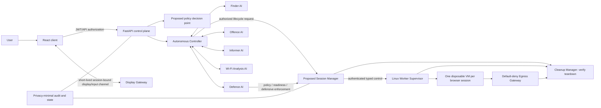
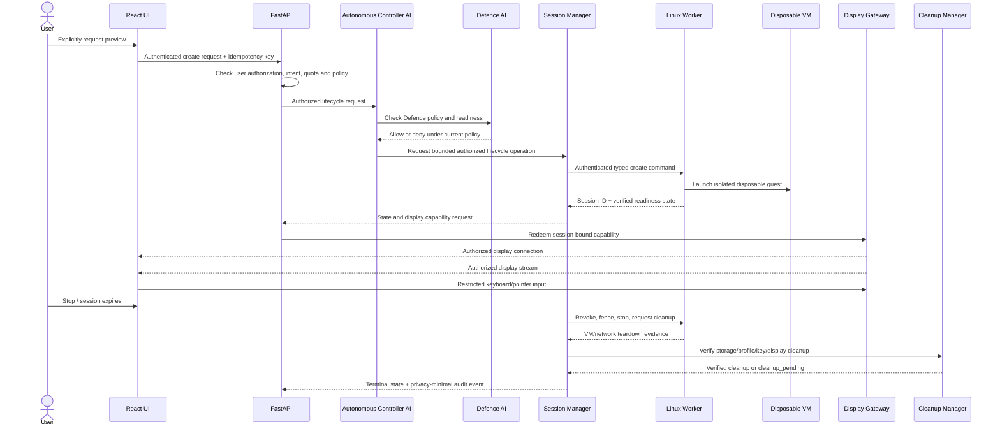

# Guard AI Master Architecture

**Canonical master architecture.** **Status:** approved documentation decisions and proposed design; not implementation evidence. Existing application facts below were checked against this repository. No runtime change is made by this document. Browser details are canonical in [ISOLATED_BROWSER_ARCHITECTURE.md](ISOLATED_BROWSER_ARCHITECTURE.md); security findings are canonical in [SECURITY_AUDIT_FINDINGS.md](SECURITY_AUDIT_FINDINGS.md).

## Architecture decision record — 2026-11-02

| Decision | Recorded decision | Status / boundary |
|---|---|---|
| Defence ownership | Defence AI is the policy and product owner for isolated browsing, URL protection, sandbox policies, private-session policies, isolation readiness and defensive session enforcement. | Approved architecture decision; all such runtime controls remain proposed and unimplemented. |
| Execution separation | Session Manager owns session lifecycle; Worker Supervisor owns VM lifecycle; Egress Gateway enforces network policy; Display Gateway mediates display/input; Cleanup Manager performs and verifies teardown. These execute within Defence policy constraints and have no authority to weaken them. | Proposed component contracts, not deployed. |
| Private-session model | One disposable isolated VM per browsing session. Tabs within a session share its profile/storage. Different sessions have separate VMs and profiles. Closure initiates cleanup and the session is not reported destroyed until required teardown is verified. Incognito/private mode alone is not isolation. | Proposed; details in canonical browser architecture. |
| Six-agent target | Autonomous Controller AI, Finder AI, Defence AI, Offence AI, Informer AI, and Wi-Fi Analysis AI. | Target design; Wi-Fi remains nested under Finder in current source and is not promoted by this decision. |
| Canonical records | This file is master; `ISOLATED_BROWSER_ARCHITECTURE.md` is browser design; `SECURITY_AUDIT_FINDINGS.md` is security findings register. | Earlier documents remain research/summaries and must link here rather than silently diverge. |

Hosting and operational approvals remain pending; see the readiness checklist below. These decisions approve documentation architecture only, not implementation or spending.

## Purpose and architecture preservation

Guard AI remains a defensive security application with six primary agent roles: Autonomous Controller, Finder, Defence, Offence, Informer, and Wi-Fi Analysis. The six-role model is the target architecture. The current source has five primary agents; Wi-Fi is a specialized agent instantiated through Finder. This document does not silently promote or rewrite it.

The existing project remains a Windows React/Vite dashboard and FastAPI control plane, with local SQLite and in-process agent event bus. URL review is local heuristic analysis and does not fetch or render a site. Genuine isolated browser preview remains unimplemented. Browser worker, VM supervisor, egress gateway, remote display, independent policy service, signed agent protocol and watchdog are proposals.

## Existing implementation and target

| Capability | Repository evidence / current state | Target treatment |
|---|---|---|
| Autonomous Controller AI | Coordinates threat events, severity, audit records, Defence vault lock and user briefing in the FastAPI process. API identity authorization is separately enforced by FastAPI dependencies. | Keep lifecycle coordination separate from API authentication and the durable worker watchdog. |
| Finder AI | Performs local URL, file, text and submitted network-data heuristics. | Preliminary findings only; no safe guarantee and no automatic browser launch. |
| Defence AI | AES-GCM vault/key workflows, lock state and threat-triggered protection. | Preserve vault and Cryptographic Maze behavior. Defence owns browser policy/product decisions and defensive enforcement; separate execution services perform lifecycle, VM, network, display and cleanup operations. No runtime capability is implied. |
| Offence AI | Defensive local incident/demo behavior. | Emergency containment coordination only; no external attacks or unauthorized scanning. |
| Informer AI | User-facing explanations and briefings. | Risk/status notification; never automatic cyber-authority reporting. |
| Wi-Fi Analysis AI | Specialized Finder component analyzes supplied network parameters. | Target sixth primary role; live scanning/monitoring is not present and requires separate authorization and design. No source promotion is claimed. |
| Audit | Local SHA-256 linked audit records; optional local Hardhat hash anchoring adapter. | Privacy-minimal audit. Local chain is not immutable; anchoring is not a general external blockchain service. |
| Transmitter / Transformer / Rollback | No complete independent modules established by this audit. | Preserve as named supporting concepts; target interfaces and logical owners are in the component matrix. Named operators and implementation details remain pending. Do not claim they exist. |
| Cryptographic Maze Security | `crypto_maze.py` implements authenticated encryption and key derivation/recovery helpers. | Preserve as a supporting security subsystem, with key custody and host compromise limits documented. |

## Target component boundaries

The six agents exchange validated, typed, least-privilege messages. The current event bus is synchronous, in-process and unsigned; it is not that target protocol. See [GUARD_AI_COMMUNICATION_PROTOCOL.md](GUARD_AI_COMMUNICATION_PROTOCOL.md).

## Browser session flow (proposed)

Finder output is advisory data. Browser content is untrusted data and cannot become an agent instruction, authorization decision, policy update, or tool command. Wi-Fi Analysis returns authorized submitted-network analysis only; it cannot authorize browsing or worker actions.

## Component ownership and interface matrix

Every target component below is **proposed and unimplemented unless the current-state column says otherwise**. Permissions are least-privilege design requirements, not deployed ACLs. Authorization and execution components fail closed for new sessions; cleanup and incident notification remain available through independently restricted paths where safe.

| Component | Purpose / owner | Inputs → outputs | Permissions | Dependencies | Failure behavior and fallback | Required validation |
|---|---|---|---|---|---|---|
| Autonomous Controller AI | Coordinate authorized Guard AI work; application orchestration owner | Validated findings/lifecycle request → correlation, bounded coordination, status | No API auth bypass, host shell, secret access, or direct network-policy mutation | FastAPI auth context, agent protocol, PDP, state/audit | Reject malformed/stale events; no lifecycle authorization from findings; report coordination failure | Forged sender, replay, duplicate, unauthorized request, restart tests |
| Finder AI | Analyze URL/file/text indicators; Finder owns preliminary analysis | User-submitted data → evidence, score, confidence, uncertainty | Read submitted analysis input; cannot certify safety, launch session, or change policy | Input validation, privacy filters, message protocol | Return uncertain/error result; user may explicitly choose next action | Adversarial inputs, false-safe UI, raw URL leakage and no-auto-launch tests |
| Defence AI | **Policy/product owner** of isolated browsing, URL protection, sandbox/private-session policy, readiness and defensive enforcement; preserves vault/Cryptographic Maze | Context and PDP/health evidence → allow/deny policy, constraints, readiness decision, defensive action | Author policy within approved scope; no unrestricted worker shell or guest-content access | PDP, identity registry, state, session manager, worker health, egress/display/cleanup evidence, key manager | Deny creation and fence/revoke on uncertain controls; invoke safe mode; preserve vault lock protections | Policy bypass, stale readiness, gateway loss, cleanup failure, vault regression tests |
| Offence AI | Defensive emergency containment coordinator | Validated incident signal → bounded containment request/status | No external attack, exploit, unauthorized scan, arbitrary shell, or authority reporting | Controller, Defence policy, safe mode, audit | Request safe mode/containment; if unavailable alert operator and keep launch denied | Verify only defensive allowlist and approval/audit boundaries |
| Informer AI | Authorized-user notifications | Allowlisted status/risk metadata → plain-language notification | Read minimal metadata; no page DOM, secrets, external reporting or control actions | Controller, privacy rules, UI notification path | Suppress unsafe payload and surface generic failure | Canary-secret/content injection, recipient and no-auto-report tests |
| Wi-Fi Analysis AI | Analyze authorized supplied wireless configuration | Submitted parameters → risk indicators and defensive recommendations | No unauthorized live scanning, interference, exploitation or network changes | Input schema, Finder-compatible analysis, protocol | Reject absent/unauthorized data; return uncertainty | Supplied-data boundary and network-side-effect tests |
| Policy Decision Engine (PDP) | Central policy decision point; Defence owns policy, independent service enforces decisions | Authenticated principal/workload + action/resource/context → versioned allow/deny/constraints | Decision only; no execution or self-issued identity | Identity registry, policy store, trusted clock, audit | Missing/stale/unavailable decision = deny; cached allow only if explicitly bounded and approved | Decision matrix, stale policy, bypass and policy-version tests |
| Agent Identity Registry | Issue/map/revoke workload identities; logical owner: Security Operations/Identity Administrator (named operator pending) | Enrollment/rotation/revocation request → scoped identity metadata | Registry admin separate from agents; no user session authority | Protected key manager, owner/approver, audit | Unknown/revoked identity rejected; rotation outage denies new trust | Expiry, revocation, impersonation and rotation tests |
| Secure Communication Gateway | Authenticated, schema-bounded cross-process transport; logical owner: Platform Security (named operator pending) | Signed/identified typed messages → validated routed messages/results | Allowlisted operation and audience only; no arbitrary payload forwarding | Identity registry, keys, schemas, replay state, network ACL | Reject auth/schema/replay failures; bounded retry for idempotent operations | Spoof, replay, oversized payload, wrong audience and outage tests |
| Watchdog | Independent liveness/readiness and stale-session reconciliation; logical owner: Worker Operations (named operator pending) | Worker/state/health evidence → readiness and reconciliation action | Read health; stop only tagged Guard AI resources; no policy weakening | Durable state, supervisor, firewall/gateway evidence, identity | Deny launch, revoke/fence, reconcile owned sessions; alert on uncertainty | Stale health, partition, restart, orphan and unrelated-resource safety tests |
| Security State Manager | Durable policy/session/security state; logical owner: Platform Engineering (named operator pending) | Authorized transition → atomic versioned state/result | Scoped record access; no guest content | Database, migrations, identity, audit, watchdog | State uncertainty denies create/ticket; cleanup reconciliation remains possible | Crash consistency, concurrency, rollback and split-brain tests |
| Secret and Key Manager | Custody/rotation/revocation of service and ephemeral session keys; logical owner: Security Operations (named operator pending) | Approved key operation → scoped key handle/result | Non-exporting access where supported; no guest/user JWT exposure | Protected keystore/HSM decision, identity, audit, recovery | Key unavailable denies launch; revoke/expire affected capabilities | Rotation, access control, backup/restore, key destruction tests |
| Audit Manager | Privacy-minimal attributable records; logical owner: Audit/Security Operations (named operator pending) | Allowlisted events → integrity-protected audit record | Append/verify; tightly controlled read; no browser contents | State manager, identity, privacy manager, key manager | Audit failure blocks new sessions; cleanup continues and reports failure | Tamper, retention, access, redaction, canary and outage tests |
| Update Manager | Verify and stage control-plane/worker/image updates; logical owner: Release Engineering (named operator pending) | Signed provenance and policy → approved staged version/rollback request | Cannot override policy or deploy unverified artifact | Signing keys, registry, audit, recovery/rollback | Reject signature/provenance mismatch; retain last approved image only if policy permits | Signature, revocation, staged rollout and rollback drills |
| Recovery Manager | Restore approved state/services and coordinate incident recovery; logical owner: Incident/Recovery Operations (named operator pending) | Incident/state evidence → recovery plan and bounded actions | No unilateral policy weakening; operator approval for high-impact restore | Safe mode, state/audit backups, key manager, watchdog | Remain contained if integrity uncertain; require operator intervention | Restore, corrupted backup, key-loss and recovery authorization tests |
| Privacy Manager | Enforce collection minimization, purpose, retention and deletion rules; logical owner: Privacy Officer (named operator pending) | Approved purpose/data class → allow/deny collection and retention action | No access to page content by default; audited policy administration | Data inventory, audit, state, legal/privacy decisions | Unknown retention rule blocks optional collection; keep minimum operational metadata | Data-flow inventory, deletion, retention expiry and access tests |
| Resource Manager | Admission, per-user/session/global limits and cost guardrails; logical owner: Worker Operations/FinOps (named operator pending) | Capacity/quota request → admit/reject/limits | Enforce ceilings independently on worker | State, host telemetry, approved budget/concurrency | Reject on stale capacity or ceiling; stop/fence according to policy | Saturation, quota bypass, cost alert and runaway cleanup tests |
| Emergency Safe Mode | Cross-system emergency deny/revoke/fence state; Defence owns policy, Offence may request | Authorized trigger/evidence → deny new sessions, revoke display, fence guests, alert | Trigger authority scoped; recovery requires designated operator checks | PDP, watchdog, state, gateway, display, audit, recovery manager | If partial activation, deny creates and raise high-priority operator alert; no auto-resume | Fault injection proving deny/revoke/fence and guarded recovery |
| Transmitter | Deliver approved notifications/messages; logical owner: Informer AI (named product operator pending) | Allowlisted event → user-facing delivery receipt | No authority to create sessions or report externally without explicit consent | Secure gateway, Informer, privacy and audit | Queue bounded metadata or fail visibly; never silently broaden recipients | Recipient allowlist, duplicate and sensitive-payload tests |
| Transformer | Transform/anchor approved audit data; logical owner: Audit Manager (named operator pending) | Minimized event/hash → versioned transform/optional anchor result | Hash/minimized metadata only; no secret or raw page data | Audit Manager, schema, optional local blockchain adapter | Local audit remains authoritative; anchoring unavailable is explicit, not falsely successful | Deterministic transform, hash verification, local-chain outage tests |
| Rollback | Restore previously approved software/policy/image version; logical owner: Update Manager with Recovery Manager approval (named operators pending) | Verified prior artifact + authorized rollback → version transition | Cannot roll back identity revocation or weaken emergency deny automatically | Update Manager, Recovery Manager, signatures, audit | If prior state cannot be verified, remain contained | Rollback integrity, downgrade prevention and post-rollback tests |
| Session Manager | Own browser session lifecycle/owner/quota/state | Authenticated explicit create/status/stop → state and scoped capability request | No arbitrary commands; owner checks each operation | FastAPI auth, PDP, Defence policy, state, worker, audit, resource manager | Deny create/ticket on uncertain state; idempotent stop/reconcile | Ownership, concurrency, idempotency, restart and quota tests |
| Worker Supervisor | Create/inspect/stop one VM per session | Fixed image/policy/resource command → VM status and teardown evidence | Local restricted API; Guard AI-tagged resources only; no guest secrets | Linux/KVM/Firecracker, signed image, host firewall, identity | No launch on failed readiness; fence and report unknown cleanup | Image integrity, escape boundary, resource and restart tests |
| Egress Gateway | Enforce DNS/destination/protocol/network policy | Guest proxy request → allowed connection or deny/log-minimal event | Guest egress only; no control/management route | Defence policy, host firewall, resolver, state/version | Gateway failure leaves host default-deny; no direct fallback | IPv4/IPv6, SSRF, rebinding, redirect, proxy-bypass packet tests |
| Display Gateway | Mediate remote display and restricted input | Redeemed session capability + display stream/input → authorized stream | Assigned session only; keyboard/pointer only by default | Identity, ticket store, session manager, isolated display network | Revoke on uncertainty/stop/expiry; no cross-session fallback | Replay, origin, malformed input, route isolation and revocation tests |
| Cleanup Manager | Perform and verify session teardown | Stop/timeout/failure → VM, profile/key, network, ticket and storage checks | Delete only owned session resources; cannot claim physical erasure | Supervisor, key manager, display gateway, egress, watchdog, audit | `cleanup_pending`, quarantine capacity, retry boundedly, alert; never report destroyed without evidence | Partial-failure injection, key/profile/network/process verification and remanence tests |

Logical owners describe target accountability; named operators and organizational approval remain pending before implementation. This matrix does not claim these components exist.

## Independent supporting infrastructure (proposed)

The target deployment separates: API authentication/authorization; policy decision and enforcement; workload and agent identity; authenticated communication; durable session state; worker supervision; health/readiness and watchdog/reconciliation; key custody and rotation; audit and privacy controls; update/image signing and rollback; safe mode; resource admission/quotas; incident operations and monitoring. These are distinct responsibilities, not assumed current services.

Browser isolation requires a separately approved Linux/KVM worker (Firecracker compatibility and hosting remain pending), a host firewall whose default-deny rule persists through gateway failure, a policy egress gateway, a session manager, disposable VM/profile storage, and a remote display/input service. Worker control and display paths must be separate; browser guests must not reach the control plane, host, LAN, cloud metadata, or other sessions. Exact topology and provider remain undecided.

## Security principles and unresolved choices

- Deny by default; enforce restrictions outside the guest, and fail closed when worker, policy, gateway, identity or health state is uncertain.
- Bind each expiring, single-session capability to user, session, scope, audience and nonce; prevent replay and revoke on stop, timeout, ownership loss or incident.
- Validate destinations at connection time and after DNS resolution/redirects; block loopback, private, link-local, reserved and metadata ranges in IPv4 and IPv6. Prevent direct DNS, QUIC, alternate proxy and tunnel bypasses. Domain allowlisting remains a product decision.
- Apply CPU, memory, disk, process, bandwidth, connection, duration and concurrency limits. Cleanup must remove VM, overlay, profile, temporary download data, network attachment and display capability; verify cryptographic erasure limits for physical media.
- Do not store page contents, credentials, keystrokes, clipboard, screenshots or downloads in audit logs. Retention, telemetry, privacy jurisdiction and user consent remain pending.
- VM isolation lowers risk but does not eliminate hypervisor/kernel escape. Host compromise, control-plane compromise, supply-chain compromise and denial of service remain residual risks.
- Emergency Safe Mode is a proposed, independently triggerable state: deny new sessions, revoke display capabilities, fence affected guests, retain minimal evidence, alert the authorized operator and require explicit recovery criteria. It is not currently implemented.

## Six primary agent responsibilities

Detailed contracts are in [GUARD_AI_AGENT_SPECIFICATIONS.md](GUARD_AI_AGENT_SPECIFICATIONS.md). Preserve existing Finder, vault, containment-demo, notification, audit and cryptographic ideas while adding planned roles and controls explicitly. Offence is defensive containment only; Informer never reports externally without explicit user consent.

## Further design records

- [Security extensions](GUARD_AI_SECURITY_EXTENSIONS.md)
- [Loophole audit](GUARD_AI_LOPWHole_AUDIT.md)
- [Communication protocol](GUARD_AI_COMMUNICATION_PROTOCOL.md)
- [Implementation roadmap](GUARD_AI_IMPLEMENTATION_ROADMAP.md)
- [Testing and validation](GUARD_AI_TESTING_AND_VALIDATION.md)
- [Consolidation changelog](GUARD_AI_CHANGELOG.md)
- Canonical records: this master architecture, [isolated browser architecture](ISOLATED_BROWSER_ARCHITECTURE.md), and [security findings register](SECURITY_AUDIT_FINDINGS.md). [BROWSER_ISOLATION_ARCHITECTURE.md](BROWSER_ISOLATION_ARCHITECTURE.md) is retained as earlier research; [PRE_IMPLEMENTATION_SECURITY_AUDIT.md](PRE_IMPLEMENTATION_SECURITY_AUDIT.md) and [GUARD_AI_LOPWHole_AUDIT.md](GUARD_AI_LOPWHole_AUDIT.md) are audit summaries that defer to the canonical findings register.

## Implementation readiness checklist

All items below remain **pending approval or technical confirmation**. No approval is inferred:

- [ ] Worker ownership and operational responder.
- [ ] Host specification and demonstrated Linux/KVM/Firecracker compatibility.
- [ ] Hosting region/jurisdiction.
- [ ] Monthly budget, spend ceiling and shutdown authority.
- [ ] Privacy, consent, data inventory and retention/deletion policy.
- [ ] Local versus remote execution model and control-plane reachability.
- [ ] Expected users/concurrency and resource ceilings.
- [ ] Display transport, authentication handshake, topology, ports and network ACLs.
- [ ] Egress topology, DNS/proxy policy and allowed protocols/destinations.
- [ ] User and service authorization model, identity issuer and recovery authority.
- [ ] Android client scope and supported display/input behavior.
- [ ] Named operational owners for updates, keys, audit, privacy, recovery and incident response.

**Readiness: NO-GO.** Resolve approvals, then complete design/interface gates before Phase A. Documentation decisions do not authorize infrastructure or runtime implementation.
