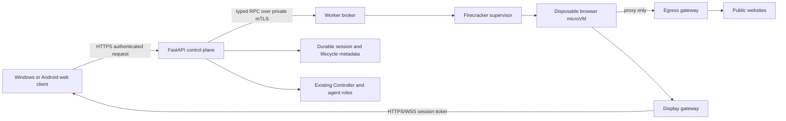
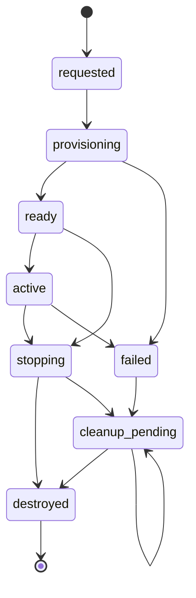

# Guard AI Isolated Browser Infrastructure Feasibility

**Feasibility research and assumptions.** Current architecture decisions are in [GUARD_AI_MASTER_ARCHITECTURE.md](GUARD_AI_MASTER_ARCHITECTURE.md); canonical browser design is [ISOLATED_BROWSER_ARCHITECTURE.md](ISOLATED_BROWSER_ARCHITECTURE.md), and findings are in [SECURITY_AUDIT_FINDINGS.md](SECURITY_AUDIT_FINDINGS.md). This assessment remains evidence and estimates, not approval to host or provision infrastructure.

## Scope and evidence labels

This assessment evaluates the proposed isolated browser system before implementation. It does not implement or test a browser runtime, provision infrastructure, or claim production readiness.

- **Verified** means observed in this repository or in the read-only Windows inventory described below.
- **Assumption** means a planning input that still needs confirmation.
- **Recommendation** means a proposed decision, not an implemented feature.

The architecture references are [ISOLATED_BROWSER_ARCHITECTURE.md](ISOLATED_BROWSER_ARCHITECTURE.md) and [BROWSER_ISOLATION_ARCHITECTURE.md](BROWSER_ISOLATION_ARCHITECTURE.md). The existing application boundary is described in [ARCHITECTURE.md](ARCHITECTURE.md), [ROADMAP.md](ROADMAP.md), and [README.md](../README.md).

## Existing implementation and host findings

### Verified repository state

The current application is a Windows-oriented React/Vite frontend and FastAPI backend. The backend defaults to `127.0.0.1`; the frontend calls it locally. Protected API routes use configured bearer authentication and role checks. Finder performs local URL heuristics; `POST /api/v1/sandbox/preview-url` does not fetch or render a remote page. The existing Controller AI, Finder AI, Defence AI, Offence AI, and Informer AI remain in the same backend process. There is no browser session manager, VM supervisor, worker RPC, egress gateway, remote display service, or browser lifecycle cleanup implementation. The Android workflow is explicitly a demonstration, not a native or paired client.

The repository's documented test-definition counts remain 39 backend pytest tests and 19 frontend Node.js cases. They are counts from source/configuration, not test execution results. This assessment did not run application tests.

### Verified development host inventory

Read-only Windows inventory for the development machine reported:

| Property | Observation | Feasibility implication |
| --- | --- | --- |
| Operating system | Windows 11 Home Single Language, build 26300 | Hyper-V role is not supported on Windows Home; this is not a supported local Hyper-V worker configuration. |
| Device | HP Pavilion x360 2-in-1, model family 14-ek1xxx | Laptop-class host; sustained concurrent browser sessions need thermal and resource testing. |
| CPU | Intel Core i5-1335U; 10 cores, 12 logical processors | CPU capacity alone does not establish that a usable KVM or Hyper-V host is available. |
| Memory | 15.7 GiB reported | Below the 32 GiB planning target for a small separate worker with a few sessions; usable headroom would be lower while Windows and development tools run. |
| Virtualization indicators | `HypervisorPresent=True`; processor inventory reported `VMMonitorModeExtensions=False`, `SecondLevelAddressTranslationExtensions=False`, and `VirtualizationFirmwareEnabled=False` | The indicators conflict. The available inventory does not establish that hardware virtualization is exposed to a local Linux/KVM or Hyper-V host. Recheck firmware and host exposure only if local hosting is reconsidered. |
| WSL | `wsl --status` reports WSL is not installed | No existing WSL Linux environment is available; installing/configuring it is outside this assessment and would not by itself establish supported Firecracker/KVM operation. |
| Disk | C: reported about 155 GiB free; D: about 202 GiB free | Capacity is ample for a prototype image cache if both volumes are available, but the inventory does not establish separate physical disks, performance, or a safe persistence boundary. |

The inventory is a point-in-time observation. It does not reveal firmware setup, whether virtualization is disabled by policy, whether the reported processor flags are masked, sustained performance, network quality, or disk type. Do not infer local virtualization readiness from `HypervisorPresent=True` because the processor capability fields disagree.

Microsoft documents Windows 10/11 Pro or Enterprise, SLAT, hardware-assisted virtualization, and minimum memory among Hyper-V requirements; Windows Home does not provide the Hyper-V role ([Microsoft Hyper-V requirements](https://learn.microsoft.com/en-us/windows-server/virtualization/hyper-v/get-started/install-hyper-v)). Firecracker's host requirements are Linux on a supported architecture with usable KVM (`/dev/kvm`) ([Firecracker getting started](https://github.com/firecracker-microvm/firecracker/blob/main/docs/getting-started.md)). WSL is not a substitute unless a specific supported KVM exposure path is demonstrated; none is verified here.

**Assessment:** Running the proposed Firecracker worker on this Windows laptop is not practical or supported based on current evidence. Local Windows Hyper-V is also blocked by the Home edition. The conflicting virtualization inventory is a further unresolved prerequisite, not a reason to change system settings during this documentation task.

## Hosting model comparison

| Model | Feasibility for Guard AI | Benefits | Costs and risks | Assessment |
| --- | --- | --- | --- | --- |
| Local Linux/KVM worker on the current laptop | Not feasible as observed. The host is Windows Home, WSL is absent, and KVM access is not present or verified. | Lowest network latency; local control; no cloud worker bill if suitable hardware already existed. | Requires separate Linux/KVM host or conversion/reconfiguration; laptop's 16 GiB class memory is tight; thermal, availability, backup, patching, and public egress IP remain concerns. | Do not target this laptop. A separate on-prem Linux host could be reconsidered if already available and administratively supported. |
| Cloud-hosted Linux/KVM worker | Technically feasible only on an instance/provider that exposes KVM, commonly dedicated/bare-metal capacity. Ordinary cloud VMs must not be assumed to expose nested virtualization. | Central availability, remote clients, reproducible worker provisioning, easier separation from user endpoint. | Bare-metal capacity is substantially more expensive than a general small VM; egress/display traffic, gateway, logs, storage, and operational monitoring add cost. Cloud operator and region become privacy/residency dependencies. | Viable after region, provider, KVM capability, budget, and data handling are approved. Start with a single worker and strict spend limits. |
| Windows control plane with a remote Linux/KVM worker | Recommended architecture for an MVP. Keep the existing Windows app local initially; place the browser runtime on a separate supported Linux/KVM host reachable over a private authenticated channel. | Preserves the current app and agent roles; avoids local Windows virtualization constraints; keeps hostile browsing away from the Windows client; supports Android web access later through deliberate HTTPS/WSS deployment. | Adds a distributed trust boundary, worker lifecycle and network operations, secure connectivity, and a dependency on remote host availability. Current loopback API is not remotely accessible. | Preferred integration shape. Use already-owned/on-prem Linux hardware if available; otherwise compare a time-bounded cloud bare-metal pilot with a budget cap before provisioning. |

### Recommended deployment shape

**Recommendation:** Retain React/FastAPI and all five existing AI roles as the control plane. Add a separately administered Linux/KVM worker running one disposable Firecracker microVM per session. Connect FastAPI to a small worker broker over private networking with mutual TLS (mTLS) or an equivalent workload identity, short-lived credentials, and a narrow typed API. Do not expose the Firecracker API or worker management ports publicly. Place the guest behind a default-deny network policy and controlled egress gateway. Carry remote display separately over authenticated HTTPS/WSS.

For an MVP, choose a single worker host, one region/location, fixed signed guest image, one browser, and low concurrency. If Guard AI has no suitable on-prem Linux host, cloud bare metal is feasible but should be an explicit budget/region decision; always-on dedicated metal may be uneconomic for an intermittent prototype. Do not select a provider or purchase capacity until usage, region, privacy requirements, and spending ceiling are known.

## Control-plane to worker communication

The current React frontend should continue to call FastAPI, not the worker. FastAPI authorizes the user and makes fixed operations through a worker broker: create session, get status, stop session, and reconcile stale sessions. The broker must reject arbitrary shell commands, user-supplied VM parameters, mount paths, image identifiers, network routes, or host file references.

For a remote worker:

1. Keep the existing API loopback-only during local development. A remote or Android deployment requires a deliberately configured HTTPS reverse proxy/identity gateway; do not simply bind the current API to a public interface.
2. Put the worker broker and control plane on a private VPN/VPC network or a mutually authenticated outbound tunnel. Permit only the broker's control port from the control-plane identity. Keep SSH/administration separate and restricted to operators.
3. Authenticate worker RPC using mTLS workload identity or equivalent short-lived signed service credentials, rotate credentials, validate peer identity, and maintain revocation. User API bearer tokens must never be forwarded to the guest or used as worker credentials.
4. Return an opaque session identifier and a short-lived, single-use display capability bound to user, session, expected origin, and expiry. Exchange it through a protected handshake, not query parameters. Reject replay, wrong-origin, wrong-owner, and expired tickets.
5. Keep browser egress and display/control networking distinct. The guest can reach only the egress proxy and the minimum display channel required. It cannot route to FastAPI, databases, worker administration, the supervisor, or another session.
6. Fail closed if control identity, policy version, image signature, egress policy, or display authorization cannot be verified.

The current SQLite/audit setup is local prototype infrastructure. Distributed sessions need durable, concurrency-safe lifecycle state and reconciliation before multiple API processes or worker hosts are supported. Keep audit data minimal: actor, opaque session, timestamps, policy/image version, lifecycle outcome, and categorized failure. Avoid page content, screenshots, cookies, credentials, stream tickets, and sensitive URL query strings.

### Proposed request and data flow

The diagram is a proposed connection map, not a description of deployed services. AI roles remain in the existing control plane and do not receive direct worker-shell access. Website content stays in the disposable guest and is represented to the client as a remote display stream.

### Proposed session states

`destroyed` means cleanup was verified. `cleanup_pending` is an operational fault requiring retry and alerting; it must not be treated as a successful stop or silently forgotten.

## Networking, sessions, streaming, and cleanup requirements

### Network egress

- Attach each guest to a deny-by-default virtual network. No direct Internet route and no route to host, LAN, control-plane, cloud-management, metadata, or other guests.
- Route permitted web requests through an isolated egress proxy/gateway. Validate destination IPs at connection time, including every redirect and retry; reject loopback, private, link-local, reserved, multicast, IPv4-mapped IPv6, and metadata ranges. Pin the validated DNS result for the connection while preserving hostname verification. These controls address DNS rebinding and SSRF risks described in the [OWASP SSRF Prevention Cheat Sheet](https://cheatsheetseries.owasp.org/cheatsheets/Server_Side_Request_Forgery_Prevention_Cheat_Sheet.html).
- Block direct DNS, DoH bypass where enforceable, UDP/QUIC, WebRTC/STUN, and unapproved ports. Apply policy at both guest/host firewall and gateway; a proxy configuration alone is not enforcement.
- Rate-limit sessions and connections; cap bandwidth, duration, request size, and concurrent sessions. Gateway failure must stop or block browsing rather than enable direct access.
- Record only necessary destination and policy metadata with an explicit retention period. A remote website will see the worker's egress IP; a hosted provider is also a data processor and region matters.

### Session lifecycle and authentication

Use a persisted state machine such as `requested → provisioning → ready → active → stopping → destroyed`, with explicit `failed` and `cleanup_pending` states. Every transition should have an owner and timeout. A session is not `destroyed` until the VM process, network attachment, writable disk/profile, display mapping, and temporary credentials are verified removed or revoked. On worker restart, reconcile only resources tagged as Guard AI sessions; never terminate unrelated VMs.

Enforce ownership checks on every status/stop/stream operation, random non-sequential IDs, per-user quotas, maximum session duration, idle timeout, one-time display ticket, replay protection, and revocation on stop. The API token authorizes the control-plane request only; the stream ticket is a separate, narrowly scoped capability. Avoid secret-bearing URLs and logs. If durable session storage is unavailable or inconsistent, refuse new sessions.

### Remote display and user input

The proposed Guacamole/VNC stack is a display/input transport only; it does not create isolation. Serve the client and stream over HTTPS/WSS through an authenticated display gateway. Bind each stream to one session and authorized user. Disable clipboard synchronization, file upload/download, drive mapping, printer, microphone, camera, USB, and arbitrary protocol extensions for the initial MVP. Validate WebSocket origin and authorization at upgrade, bound frame/connection sizes, expire tickets, and close streams on session stop or account revocation. Test the client renderer and stream parser as attack surfaces. Expect display encoding and network egress to be meaningful resource and bandwidth costs.

### Cleanup and health

Use a worker watchdog to expire idle/overlong sessions, stop crashed guests, revoke stream capabilities, remove ephemeral overlay/profile data, detach networking, and report cleanup failures. Limit per-session CPU, memory, disk, process count, and network. Health checks should verify worker capacity, supervisor responsiveness, signed image digest, gateway policy, display service, and cleanup backlog. If any required security check fails, do not launch new sessions. Alert on repeated cleanup failures, worker saturation, and policy drift.

## Resource and cost planning

The figures below are **planning estimates**, not benchmarks or provider quotes. Browser pages vary widely; measured capacity requires a later isolated pilot. Firecracker's published microVM startup and overhead measurements use minimal guest workloads and are not browser-ready or browser resource estimates ([Firecracker specification](https://github.com/firecracker-microvm/firecracker/blob/main/SPECIFICATION.md)).

| Resource | Initial planning assumption | Notes |
| --- | --- | --- |
| Worker host | 8 physical cores or equivalent, 32 GiB RAM, 250+ GiB fast SSD/NVMe, Linux with KVM; ECC/redundancy optional for a non-production pilot | Allows host, supervisor, gateway/display overhead plus a small number of sessions. Verify provider KVM access and storage performance. |
| Per browser session | Start with 2 vCPU, 2–4 GiB RAM, 4–8 GiB ephemeral writable storage, 1–2 concurrent tabs, bounded runtime | Initial caps only. Browser startup and page behavior must be measured; heavy sites may need more. |
| Worker system reserve | 4–8 GiB RAM and 2–4 cores for host, supervisor, proxy/display, and monitoring | Avoid allocating all nominal capacity to guests. |
| MVP concurrency | One session first, then two after measured load and cleanup tests | Four sessions on a 32 GiB host is a later experiment, not a guaranteed capacity. |
| Display bandwidth | Budget provisionally 1–3 Mbps per active session at moderate resolution/quality | Assumption; measure actual stream codec, frame rate, page activity, and mobile network behavior. Egress traffic and pricing depend on provider and region. |
| Image and logs | Several tens of GiB for base image versions, temporary overlays, and bounded logs | Set retention and image cleanup policy; do not retain browsing content. |

### Cost model and illustrative floor

Exact monthly compute cost cannot be responsibly quoted without a cloud, region, instance type, commitment model, uptime schedule, and data-transfer profile. For an always-on worker, calculate:

`monthly total = worker compute hours + disks/snapshots + public IPv4/load balancing + egress gateway hours and processed bytes + Internet egress/display traffic + logs/metrics + backup + support/tax`

As an **illustrative AWS network-cost floor only**, AWS's VPC pricing page gives an example NAT Gateway price of **$0.045/hour and $0.045/GB processed** in US East (Ohio); its example Internet egress rate is **$0.09/GB**. At 730 hours, one continuously provisioned NAT gateway would be about **$32.85/month before data processing and other charges**; 100 GB processed adds $4.50 and 100 GB of applicable Internet egress at the example rate adds $9. These are example rates, region-specific, subject to change, and do not include Firecracker-capable compute or other network charges ([AWS VPC pricing](https://aws.amazon.com/vpc/pricing/)). AWS states that EC2 on-demand capacity is billed while running and offers per-second billing with a 60-second minimum ([AWS on-demand documentation](https://docs.aws.amazon.com/AWSEC2/latest/UserGuide/ec2-on-demand-instances.html)); a qualifying KVM host type still must be found and priced for the selected region. Do not assume this example is a quote or that NAT Gateway is the chosen gateway implementation.

**Likely operating-cost shape (assumption):** a continuously available dedicated/bare-metal cloud host is likely to be a material monthly expense—often hundreds of USD rather than the price of a small general-purpose VM—before network, storage, and support. A time-bounded pilot can lower compute hours if the provider offers suitable capacity that can be stopped/released, but startup, persistent disks, IPs, and gateway charges may remain. An already-owned on-prem host can reduce recurring compute charges but shifts cost to hardware, electricity, connectivity, patching, backups, and on-call ownership. Obtain current regional quotes and set a hard monthly budget and usage alerts before provisioning.

## Windows and Android client limits

**Windows:** the current development laptop cannot serve as the proposed Firecracker host based on its Windows Home edition, missing WSL environment, and unverified/conflicting virtualization capabilities. It can remain the React/FastAPI control-plane development client. A remote browser is shown as pixels/input, not rendered website DOM. A future local Windows VM provider would need a separate supported edition, hardware checks, host firewall design, and independent security tests; it is not part of the recommended MVP.

**Android:** this repository has no native app or real pairing/authentication workflow. The labelled Android endpoint/workflow is demonstration data. Android could later use the web client and remote stream in a modern browser, but only after deployment behind authenticated HTTPS/WSS and responsive controls. Mobile clients introduce intermittent connectivity, sleep/background suspension, variable bandwidth, touch/keyboard behavior, and smaller displays. Do not promise native features or background session control. Stop/expiry must be enforced server-side even when the client disconnects.

## Phased MVP plan and acceptance criteria

All phases below are proposed and incomplete. Existing research/architecture docs are present; no infrastructure or runtime is implemented.

| Phase | Dependencies | Acceptance criteria |
| --- | --- | --- |
| 0. Feasibility and decisions | Confirm owner, data classification/residency, on-prem host availability vs cloud, provider/region, budget ceiling, target concurrency, retention, Android scope, and explicit implementation approval | Written deployment decision; selected host proves Linux/KVM `/dev/kvm` access, capacity, administrative ownership, private connectivity, and cost fit. If no on-prem host exists, approved cloud quote and spend cap. |
| 1. Worker foundation | Phase 0; dedicated Linux/KVM; image build/signing and patch ownership | Hardened supported Linux host; Firecracker/jailer versions pinned; signed fixed guest image verified; restricted supervisor socket; per-session resource limits; no public management endpoint; documented rebuild/patch/revoke process. |
| 2. Network containment | Phase 1; firewall and proxy ownership | Guest has no direct route; only egress gateway and required display path; canary tests prove denial to private/loopback/link-local/metadata and IPv6 targets; redirects/DNS rebinding/direct DNS/UDP bypass tests fail closed; gateway outage blocks browsing. |
| 3. Session and cleanup MVP | Phases 1–2; durable session state design; worker identity | Typed create/status/stop API over private mTLS; ownership, quota, expiry, and one-time tickets enforced; session A cannot access session B; crash/restart reconciliation removes tagged temporary state; repeated cleanup errors alert and prevent new sessions. |
| 4. Display and control-plane integration | Phase 3; display gateway; HTTPS/WSS deployment design | User sees remote display only; no clipboard/file/device transfer; unauthorized, replayed, expired, or wrong-origin tickets fail; stop/revoke closes stream; existing agents and local URL review remain unchanged. |
| 5. Client pilot | Phase 4; supported Windows browsers and Android web-browser target | Windows desktop and Android mobile browser stream/input usability documented under low bandwidth and disconnect/reconnect; disconnect does not extend server-side session lifetime; accessibility and touch/keyboard constraints recorded. Native Android remains out of scope. |
| 6. Security and capacity gate | Phases 1–5; independent reviewer and test plan | Adversarial network, token, cross-session, resource exhaustion, crash, cleanup, image integrity, display, and privacy-log tests pass; measured startup, concurrency, bandwidth, and per-session cost published; unresolved risks accepted by an owner before any wider availability. These are future tests, not test results. |

## Unresolved decisions and risks

1. **Host and owner:** no separate Linux/KVM worker has been identified. Decide who patches, monitors, backs up, and responds to worker incidents.
2. **Hosting and residency:** choose on-prem versus cloud, jurisdiction/region, retention obligations, contractual terms, and acceptable website-visible egress IP.
3. **Budget and availability:** choose uptime, pilot duration, budget ceiling, expected sessions/day, concurrency, and response time. A dedicated KVM host may dominate costs.
4. **Worker connectivity:** select private VPN/VPC, outbound tunnel, or another identity-bound private path without publicly exposing the broker or supervisor.
5. **Egress enforcement:** choose proxy and DNS design, IPv6 behavior, TLS policy, allowed ports, and how to handle sites requiring WebRTC, UDP, downloads, or unusual protocols. The MVP should deny unsupported paths.
6. **Display stack:** confirm Guacamole/VNC suitability, licensing/maintenance, codec, mobile browser behavior, WebSocket termination, and protection against display-client vulnerabilities.
7. **Durable lifecycle state:** define ownership, database migration, concurrency/locking, restart reconciliation, audit retention, and handling of partial cleanup.
8. **Guest image:** select kernel/base distribution/browser version, update cadence, signing/revocation, startup time, and whether site data is retained at all. Recommendation is no persistent browser profile.
9. **Threat residuals:** browser and kernel zero-days, Firecracker/KVM/host compromise, gateway bypass, compromised display service, malicious user input, denial of service, and metadata leakage remain possible. Isolation reduces exposure but is not a guarantee.
10. **Regulatory and user consent:** decide whether users may enter credentials or download files. These should remain disabled in the MVP unless separately threat-modeled and approved.

## Decision summary

**Recommended model:** Windows React/FastAPI control plane plus a separate, private Linux/KVM Firecracker worker; use an already-owned on-prem host if one meets the requirements, otherwise evaluate a short, budget-capped cloud bare-metal pilot. The current Windows laptop is not a viable local worker.

**Blockers before implementation:** no worker host is identified; local virtualization is unavailable/unverified; cloud region/provider and budget are undecided; remote control-plane exposure/authentication, durable session state, egress enforcement, and display delivery need an approved design. Browser runtime implementation remains unstarted and requires the approval gate in the architecture document.

## Worker communication implementation status

The backend now contains a worker identity, ticket, and signed-health validation foundation, but production worker communication is not deployed. Internal worker routes accept peer identity only from the ASGI `scope.extensions.tls.client_cert` value; they do not trust certificate headers. The current `backend/run_backend.py` starts the API as loopback HTTP and does not provide this TLS evidence. No approved TLS terminator or ASGI server adapter, worker host, CA/CRL distribution process, or production ticket-key custody is present. Therefore worker enrollment and mTLS routes remain unavailable under default configuration.

Before enabling these routes, an infrastructure operator must approve and configure a private worker endpoint whose TLS terminator requires client certificates and passes the peer certificate through a documented, server-controlled ASGI TLS extension. If a proxy is introduced, it must strip inbound certificate-assertion headers, authenticate its upstream boundary, and keep the backend listener unreachable except through that proxy. The operator must also provision a worker CA, a fresh issuer-signed CRL, and a separate ticket-signing key and verification-key rotation set; access logs must omit ticket response bodies. The local TLS tests use a test-only TLS-to-ASGI bridge and do not validate `run_backend.py` or any production deployment.

### Certificate and ticket-key operations

- Generate each worker private key on the worker host and keep it there. Submit only the CA-signed public certificate and any required intermediate certificates to the admin-only enrollment endpoint. The certificate must be valid for client authentication, and its issuer's current signed CRL must be configured and must not list the certificate as revoked.
- For renewal, issue the replacement certificate and use the admin-only certificate-renewal endpoint. The previous fingerprint stops authenticating when renewal commits. Confirm the new certificate works over the approved mTLS endpoint before retiring the old private key. Worker revocation is a separate admin operation and invalidates outstanding tickets.
- Publish a newly signed, current CRL through the approved deployment process and restart/reload the service so the process reads it. Missing, malformed, expired, or revoking CRLs deny worker authentication. CRL refresh monitoring and deployment automation are not implemented.
- Rotate ticket signing keys by setting a new key ID and key in the secret store, retaining the previous key in the verification-key set for the outstanding-ticket lifetime (maximum five minutes), and restarting the service. The app audits active key-ID changes without storing key material. Remove the previous verification key after old tickets expire. Secret-store custody, approval workflow, backup, and automated rotation remain operator responsibilities.

The ticket-signing key must be provisioned by an operator from a cryptographically secure source; the application does not generate a replacement key at startup. Configuration validation rejects missing/short signing keys, malformed key IDs and invalid previous-key sets. Previous verification keys are accepted only when explicitly configured. Startup audits key identifiers only. Do not place key values in source control, SQLite, audit payloads or logs.

The current additive worker-ticket schema upgrade has no versioned migration framework. Before creating the delivery and per-session unique indexes, it checks for conflicting legacy sessions and, when present, delivery identifiers. It does not select or delete conflicting rows; startup fails with an actionable diagnostic so an operator can back up and review the records. The automatic upgrade is limited to transactional SQLite and PostgreSQL DDL. Other database dialects must use a separately reviewed migration before this service is started. A conflict preflight and repeat-startup test exist, but this is not a production migration rehearsal or backup/restore validation.

Ticket creation, retry delivery, redemption, redemption denial, ticket revocation, health-evidence rejection, certificate-authentication rejection, and key-ID changes append audit events using opaque identifiers and categorized outcomes; bearer tokens, signatures and key values are excluded. These entries use the repository's local hash-chain ledger, which has no independent remote checkpoint and therefore is not tamper-proof against an operator who can rewrite the full database. Audit storage failure denies the protected operation where the operation depends on an audit event. These code-level behaviors do not establish production audit durability or monitoring.
